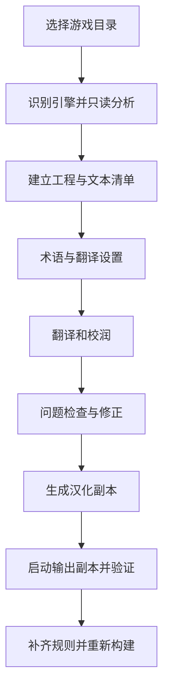
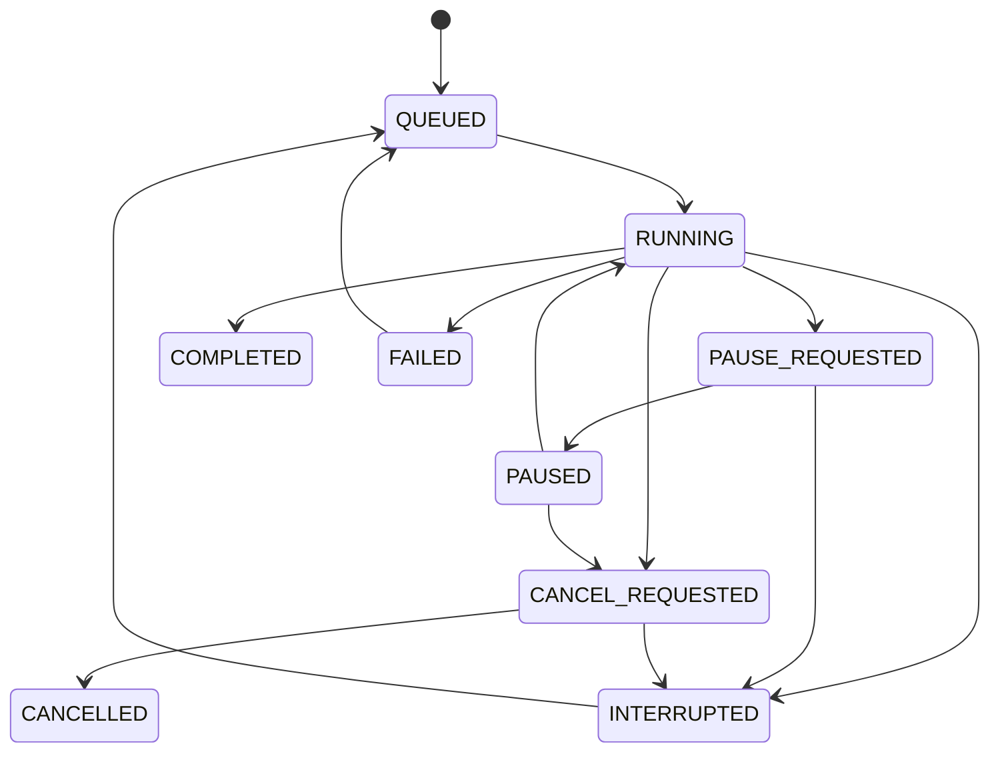

# 基于 AiNiee 的 RPG 游戏一条龙汉化工具开发计划书

版本：0.1（开发基线稿）
日期：2026-10-15（北京时间）
目标平台：Windows x64
首要语言方向：日文 → 简体中文
首个真实适配对象：《魔装影姫セレノクシア》体验版 α 0.141

> 本文是后续开发的实施依据，包含已核查事实、拟采用的设计、开发任务和验收要求。当前仅完成目录只读分析与上游源码核对；尚未创建 AiNiee fork、实现功能、调用翻译接口或完成游戏内验证。文中的新增模块、接口、命令、配置和数据库结构均为拟实现设计。

阅读索引：[目标与范围](#1-项目目标与交付范围) · [总体方案](#4-总体技术方案与工程结构) · [数据模型](#5-数据模型与持久化实现) · [当前游戏适配](#9-当前体验版的专用适配方案) · [AiNiee 改造入口](#11-ainiee-翻译体系的具体改造) · [验收要求](#17-验证矩阵与可量化验收) · [阶段排期](#18-开发阶段与工作量估算) · [任务清单](#19-可执行开发任务清单)

## 迭代约束（用户于 2026-10-20 追加，优先执行）

1. 能通过管理机制、产品约定（SOP）或界面提示解决的问题，优先在这些层面解决，
   不为可管理的使用限制新增底层框架、复杂状态或通用防护。
2. 激进迭代期间，非必要不新增单元测试或回归测试，也不为每个小改动重复运行整套
   回归。优先通过实际流程冒烟、针对已证实缺陷的最小复测和明确的人工验收记录验证。
   涉及数据损坏、写入边界或关键事务等确有必要时，才补最少的自动化检查。
3. 不过分设计、不过分兜底。复用现有组件，只处理当前需求和已证实的问题；有明确
   产品限制时直接说明，不预建多层重试、恢复、审计或假设性兼容机制。

这些约束适用于后续全部开发。下文的测试矩阵作为最终交付时按风险选择验证的依据，
不解释为每次迭代都要增加测试或重复全量回归。已完成的测试与诊断证据继续保留。
当前实施进度以 IMPLEMENTATION_STATUS.md 和各版本交付回执为准；下文保留最初设计基线。

实施决定索引：专用单写线程采用STORAGE_DECISION.md所述SQLite事务/CAS方案；
第12.4节的流式消息枚举采用WORKER_PROTOCOL_DECISION.md的一次请求协议与父作业
职责映射。这些调整按上述迭代约束复用现有组件，身份、取消、恢复和数据权威职责
保持；不会同时维护第二套仅用于匹配基线示例名称的实现。未验收范围仍明确保留。

2026-10-23用户明确接受原版两段开发草稿作为语法基线例外，第17.3.6条据此采用
“新增语法错误为0”，仅豁免已登记原版本、位置与脚本hash完全一致的两段原文。
不得扩大至其他错误，具体记录见BASELINE_SYNTAX_SOP.md及
BASELINE_SYNTAX_EXCEPTIONS.json。这是用户确认的验收调整，不宣称原版全部无错。

## 1. 项目目标与交付范围

### 1.1 要交付的产品

在 AiNiee 的翻译能力基础上，让用户在一个应用内完成：

1. 选择游戏目录，识别引擎与版本。
2. 分析游戏文本来源，建立可恢复的汉化工程。
3. 提取对话、选项、数据库说明、已适配插件与自定义文本。
4. 自动建立术语候选，复用 AiNiee 的接口、翻译、校润和人工编辑能力。
5. 检查控制符、程序结构、译文覆盖、字形与布局问题。
6. 生成独立汉化副本或与明确游戏版本绑定的补丁。
7. 在输出副本中验证运行，记录未覆盖场景与剩余问题。
8. 游戏更新后，在新工程中迁移能够可靠对应的旧译文。

产品中的“一条龙”指流程连续、数据互通、可恢复、结果可验证。未知格式、未知插件和未走到的剧情不能被计为已经完整支持。

### 1.2 开发优先级

| 优先级 | 必须交付的内容 | 完成定义 |
|---|---|---|
| P0：首个可用版本 | 工程管理、原生 MV/MZ JSON 提取回写、控制符保护、AiNiee 翻译接入、当前体验版专用规则、JS 指定文本对象适配、独立副本、字体检查、基础运行验收 | 当前体验版的已识别文本来源形成闭环；关键结构校验通过；完成列明路径的实机验证 |
| P1：后端整合与维护 | StevExtraction 兼容后端、RPGMTL 后端、SExtractor 后端、后端比较、跨版本迁移、运行时漏翻诊断 | 三种后端各自有版本锁定、能力声明、往返验证和独立任务隔离；迁移不会无依据覆盖译文 |
| P2：扩大自动化范围 | Translator++ 外部桥接、图片文字工作流、更广泛的插件规则、更多语言与布局策略 | 以每项功能的单独证据验收；不继承 P0/P1 未验证的兼容性声明 |

P0 覆盖普通 MV/MZ 数据，并对当前 MZ 体验版深入适配。其他 MV/MZ 游戏仍须经过扫描和兼容性检查。XP/VX/VX Ace、Wolf、Unity、Ren'Py 等不进入首版承诺范围，后续通过适配器扩展。

### 1.3 本轮文档交付与后续开发边界

- 本轮只新增本计划书，不修改游戏、压缩包或上游代码。
- 后续开发首先取得 fork 和固定源码基线，再按本文任务实施。
- 既有游戏目录始终作为只读来源；汉化结果写入独立输出目录。
- 不自动批量删除文件、目录、旧工程、失败工作目录和构建产物。需要批量清理时，显示准确路径和用途，由用户手动完成。
- 个人游戏素材、真实剧情、存档和运行日志不进入公开仓库、CI 附件或发行包。

## 2. 已核查的技术基线

### 2.1 上游源码快照

以下 SHA 是本计划编写时实际读取的 Git 树对应提交；开发启动时重新核对远端，将最终采用版本写入依赖锁定文件。

| 项目 | 已核查提交 | 观察到的事实 | 对实现的影响 |
|---|---|---|---|
| AiNiee | `7bbb06be33f5968f0723a5200a150d895d4fa5fb` | Python、PyQt5；存在 Reader/Writer、CacheProject/CacheItem、TaskExecutor；仓库附带 StevExtraction | 保留翻译体系，新增游戏工程服务和结果提交入口 [S1]、[S2]、[S3]、[S4]、[S5] |
| RPGMTL | `0fa346b020e439fd392027f735107a283c9836d9` | JSON 插件识别 MV/MZ 事件；插件回写依赖所属项目的状态 | 包装既有工程上下文，或抽取纯解析部分；不能当作无状态函数直接接入 [S6]、[S7] |
| SExtractor | `8d8d976fd04ae54e7c677705af937273d04a376a` | 有 JSON、RPGMV 等提取模块；主入口使用共享 ExVar 状态 | 使用独立工作进程，不在多个任务间共享模块状态 [S8]、[S9] |
| Translator++ | 公开文档与官方仓库说明 | 声明有工程格式、脚本自动化及本地 API；公开仓库以文档为主 | P2 采用可选外部桥接，先验证具体安装版本，不将声明的 API 视为已通过测试 [S10] |

AiNiee 的读写器文档中部分示例路径省略了 `Domain`，实施时以此快照的实际文件树为准。

### 2.2 当前游戏的目录与数据

来源目录：

```text
D:\Github\AI\Codex\RPG一条龙工具\selenoxia test 0.141\serenoxia project
```

| 项目 | 只读分析结果 |
|---|---|
| 引擎 | `js/rmmz_core.js` 标注 RPG Maker MZ 1.7.0 |
| 语言 | `data/System.json` 的 locale 为 `ja_JP` |
| 标准数据 | `data` 中 178 个 JSON 均可正常解析，其中地图 JSON 151 个 |
| 插件 | plugins.js 中登记 174 个，启用 168 个 |
| 对话 | code 401 共 11,252 条；按原始单行字符串去重为 9,548 条 |
| 对话块入口 | code 101 共 6,167 条；不等同于最终翻译单元数 |
| 选项 | code 102 共 240 条；选项分支 code 402 共 551 条 |
| 插件指令 | code 357 共 4,681 条；code 356 共 12 条 |
| 脚本事件 | code 355 共 1,739 条；续行 code 655 共 2,206 条 |
| 编辑器指令注释 | code 657 共 12,213 条，不能计为玩家可见台词 |
| 资源加密 | 图片与音频启用加密；主要文本 JSON 为明文 |
| 主要字体 | System.advanced 指定 `HSJP-Bold.woff`；简中字形覆盖尚未检测 |
| 自定义文字 | SH_Consts.js 注册额外 JSON；KdConsts.js 定义 Kd.words 菜单等文字 |

上述数量用于建立扫描基线，不用于直接估算最终收费条目。合并对话块、排除空白、补充自定义数据、保留不同上下文后，最终单元数会变化。

关键文件参考 SHA-256：

| 相对路径 | SHA-256 |
|---|---|
| `js/rmmz_core.js` | `03c5a7454c2f9303ccced4589304c341c12bbed6c24c6132e1a4e627347d6569` |
| `js/plugins/SH_Consts.js` | `5cc86552e8df83f42df7d8ab0bdfbb87ae8bccc9d7b254092755c1bafe07ad25` |
| `js/plugins/selenoxia/KdConsts.js` | `ce0c990b223d2088806ca603c9ee0468bb3c0b941dcdeddfa1c6bc55de876b31` |

### 2.3 已确认需要避免的直接接入方式

1. `StevExtraction/jtpp.py` 的 `ToGame` 会使用传入的 GameDir 执行额外处理，自动换行插件路径也与该目录有关。兼容后端只能接收工作副本，不能接收用户原版目录。[S2]
2. `TranslatorTask.py` 在翻译响应后处理之后直接修改 CacheItem，`PolisherTask.py` 也有直接写入路径。只在最终导出时校验，无法保证缓存中的有效译文不被无效结果覆盖。[S4]
3. `CacheManager.update_item_text`、`update_generated_translation`、OpenCC 转换及人工编辑也是译文变更入口，需要统一接入游戏工程提交服务。[S3]、[S4]、[S5]
4. AiNiee 现有的通用过滤、文本修复、占位符与换行规则不能默认等同于游戏语法规则；游戏工程需要声明自己采用的处理策略。
5. 源码可读、函数存在、合成样例通过、当前游戏能运行是不同证据级别；发布说明分别记录。

## 3. 产品流程与界面实现

### 3.1 用户主流程



首次分析不访问翻译服务。用户启动翻译后，使用已配置的接口执行。模型名称、价格和凭据属于运行配置，不硬编码进游戏适配文件。

### 3.2 新增“游戏汉化”入口

在 `UserInterface/AppFluentWindow.py` 注册一个新的一级页面，复用现有 Fluent Widgets 组件。

页面分为四个工作区：

| 工作区 | 展示内容 | 主要动作 |
|---|---|---|
| 工程概览 | 引擎、版本、适配状态、目录、覆盖统计、剩余问题 | 分析、重新扫描、打开工程 |
| 文本工作区 | 原文、译文、角色、来源、上下文、控制符、人工锁定 | 翻译、校润、编辑、定位、按场景筛选 |
| 检查结果 | 阻断问题、布局问题、候选漏翻、未验证来源 | 修复条目、重试、打开关联规则 |
| 构建与验证 | 构建版本、变更清单、校验结果、运行记录 | 生成副本、生成补丁、打开输出、启动副本 |

后端选择放在工程高级设置中。普通流程按能力选择适配器，界面不要求用户在多个工具窗口之间搬运文件。

### 3.3 状态与提示的产品约定

- “已翻译”表示已经有有效译文，不表示游戏内排版已验证。
- “文本校验通过”与“运行验证通过”分别展示。
- “覆盖率”必须注明分母；不得以日文字符串扫描数量冒充全部玩家可见文本。
- 遇到未知插件指令，展示插件名、命令名、涉及文件和待补规则的数量。
- 支持生成带缺项清单的测试副本；正式验收仍需满足第 17 节的门槛。
- 开发期扫描原始数据时不弹出逐文件确认框。只有缺少必要信息或确有覆盖冲突时需要用户选择。

## 4. 总体技术方案与工程结构

### 4.1 架构决策

采用“一个工程服务 + 一个权威存储 + 多个可选适配器”。

```text
PyQt5 游戏汉化页面
        │
GameProjectService（流程编排、任务与版本检查）
        ├── GameProjectStore（SQLite，权威工程数据）
        ├── AdapterRegistry（引擎与后端能力）
        ├── CacheBridge → AiNiee 翻译 / 校润
        ├── ValidationService（内容、结构、布局）
        └── BuildService（副本、补丁、清单）
                    │
        独立 Worker：JS 分析 / 兼容后端 / 运行采集
```

不新增常驻 Web 服务、远程控制平台、分布式队列或插件市场。第一版以本地单应用运行。

### 4.2 技术选型

| 部分 | 决定 | 实施要求 |
|---|---|---|
| 主应用 | 保留 AiNiee 的 Python + PyQt5 | 优先采用 Python 3.13 x64；M0 验证上游启动及打包后锁定补丁版本 |
| 工程存储 | Python 标准库 sqlite3 | WAL、外键约束、单写线程、事务提交；数据库版本迁移可回退 |
| JSON | 标准 JSON 解析与确定性写回 | 保留数组位置、空值、字段类型；无改动文件复制原字节 |
| JavaScript | 固定版本 Node Worker + Acorn | 只解析源代码；语法目标与游戏 NW.js 对应；不执行游戏脚本 |
| JS 文本修改 | 根据语法节点定位，按字节区间局部替换 | 处理 UTF-16 下标到 UTF-8 字节偏移的映射、BOM、CRLF、引号和模板文本 |
| 游戏规则 | 受限制的 YAML 配置 | safe_load；规则有 schema、版本、匹配条件和正反例 |
| 字体 | fontTools 检查 cmap；游戏渲染器检查实际宽度 | 依赖按需加载；覆盖检查与实机布局分开 |
| 进程通信 | JSON Lines 协议 | 有请求 ID、版本、大小限制、超时、取消和结构化错误 |
| 验证 | pytest + 合成数据 + 私有真实游戏验收 | 不把商业游戏素材复制到公共测试库 |
| 发行 | 沿用上游打包流程，增加后端清单 | 核心与可选后端分开检测，离线结构检查可单独运行 |

新增依赖的具体版本在 M0 锁定并跑打包验证。本计划不将“最新版本”作为长期依赖约束。

### 4.3 拟新增目录

```text
ModuleFolders/
  Domain/GameProject/
    Models.py                 # 类型、状态、版本、问题对象
    AdapterProtocol.py        # 适配器约定与能力声明
    Locator.py                # JSON / JS / 关联位置定义
    TokenPolicy.py            # 控制符和可翻译片段
    Coverage.py               # 覆盖统计口径
  Service/GameProject/
    GameProjectService.py     # 入口与操作编排
    ProjectStore.py           # SQLite 仓储、迁移、事务
    ProjectLock.py            # 单工程写入锁
    CacheBridge.py            # AiNiee 缓存投影
    TranslationCommitter.py   # 所有译文的校验与提交
    ValidationService.py
    BuildService.py
    JobController.py
    MigrationService.py       # P1 旧译文迁移
  Infrastructure/GameAdapters/
    Registry.py
    RpgMaker/
      Detector.py
      JsonExtractor.py
      EventRules.py
      JsonPatcher.py
      PluginCommandRules.py
      ProfileLoader.py
    StevBackend/              # P1 兼容后端
    RpgmtlBackend/             # P1
    SextractorBackend/        # P1
    TranslatorPlusPlusBackend/# P2
    JsWorker/
  Infrastructure/GameRuntime/
    FontInspector.py
    ProcessRunner.py
    RuntimeCollector.py       # P1
UserInterface/GameProject/
  GameProjectPage.py
  GameTextModel.py
  GameIssueModel.py
  GameBuildPanel.py
Resource/GameProfiles/
  rpgmaker-mv-base.yaml
  rpgmaker-mz-base.yaml
  selenoxia-test-0.141.yaml
Tools/
  rpg_pipeline.py             # 与 GUI 共用服务的诊断 CLI
tests/game_project/
  fixtures/synthetic/
  test_*.py
```

这些模块是新增设计；代码复用优先发生在解析内核和数据转换层，不复制第三方完整界面。

### 4.4 工程目录与原版隔离

```text
<用户选择的工程根目录>/<project-id>/
  game-project.json            # 小型入口文件，无密钥
  project.sqlite3             # 工程权威数据
  source/                     # 待修改文件的不可变快照
  manifests/                  # 全文件基线、提取与构建清单
  jobs/<job-id>/              # 每次任务的请求、结果、错误
  work/<job-id>/              # 第三方后端工作副本
  builds/<build-id>/           # 固定版本构建输入及报告
  evidence/                   # 私有运行记录与截图
<用户选择的输出根目录>/<game-name>-zh-CN-<build-id>/
```

准备工程时只读建立全文件 SHA-256 清单，保存数据和脚本等可能修改文件的字节快照。大型资源在构建时从源目录复制并核对基线；源文件变化则停止该次构建，要求重新建立或刷新来源快照。

原版目录、工程目录、输出目录不得重叠或互为子目录。默认跳过目录链接与重解析点；Windows 路径比较需要解析绝对路径、盘符和大小写语义。输出文件采用真实复制，不用硬链接共享可写文件。

## 5. 数据模型与持久化实现

### 5.1 数据权威关系

游戏工程的 SQLite 是唯一权威存储。AiNiee 的 CacheProject/CacheItem 是当前任务与界面的工作投影，不能独立覆盖工程数据。

- 扫描、编辑、翻译结果、问题状态先经过 GameProjectService 校验并提交数据库，再更新缓存投影。
- 普通文档工程继续走上游缓存路径；游戏工程通过 `project.extra.game_project` 进入新的分支。
- 游戏工程的缓存备份可以保留，但恢复时以数据库版本为准；旧缓存只允许作为导入候选。
- 每次构建通过 SQLite backup API 产生一致的输入快照，构建期间的新编辑留给下一次构建。
- 同一游戏新版本创建关联的新工程，保留旧工程；P1 迁移译文，不原地替换旧版本数据库。

使用两个不同的工程版本：`dataset_revision` 标识来源、提取结果和规则结构版本；`content_revision` 标识所有影响构建结果的内容版本。接受译文、人工编辑、修改已批准字体/布局设置时增长 content_revision；来源或规则结构变化时同时增长二者。检查结果绑定输入 digest，不能因为 dataset_revision 没变化就沿用旧译文的校验结果。

### 5.2 单元、位置与译文

`TranslationUnit` 是有上下文的一段可翻译内容。`Occurrence` 是它在源文件中的一个写回位置。一个单元可以包含多行对话，也可以关联多个必须保持一致的字段。

例如同一个选项在 code 102 和对应 code 402 中出现，两个位置应关联到同一单元。同样的日文出现在不同剧情场景时，默认保留为不同单元。

单元 ID 采用持久化 UUID；不能只用原文作为主键，也不能用每次扫描重新排列的 text_index 作为长期定位。不同工程之间通过来源结构、上下文和原文 hash 关联，关联结果可追溯。

### 5.3 核心表

所有表均在项目级数据库内。JSON 列用规范 JSON 字符串存储，由应用执行 schema 验证。

| 表 | 关键字段 | 用途与约束 |
|---|---|---|
| project | project_id、schema_version、source_root、engine、engine_version、source_manifest_hash、profile_hash、dataset_revision、content_revision、parent_project_id | 项目唯一；区分数据集版本和构建内容版本 |
| source_files | file_id、relative_path、sha256、size、encoding、newline、captured_path、adapter_id | relative_path 唯一；文件 hash 与快照对应 |
| units | unit_id、scene_id、kind、source_text、source_hash、context_json、token_policy_id、source_revision、extraction_status | 每个单元保留所属场景与提取依据 |
| occurrences | occurrence_id、unit_id、file_id、locator_json、expected_hash、adapter_id、ordinal、link_group | 位置不可重叠；多个位置共享单元时明确关联原因 |
| translations | unit_id、target_language、text、revision、source_hash、validation_status、manual_locked、model_run_id | 联合主键 unit_id + target_language；source_hash 必须与当前单元相符 |
| proposals | proposal_id、unit_id、job_id、expected_revision、text、validation_json、status | 无效、迟到、冲突或待确认结果不覆盖有效译文 |
| jobs | job_id、operation、run_state、stage、request_hash、checkpoint_json、backend_version、heartbeat、error_json | 所有恢复和重试依据 |
| issues | issue_id、unit_id、file_id、code、severity、evidence_json、fingerprint、resolution | 每次检查可对账；禁止只保存无法定位的错误文本 |
| edits | edit_id、unit_id、old_revision、new_revision、origin、reason、created_at | 编辑历史与修改来源 |
| builds | build_id、input_revision、snapshot_path、output_path、manifest_hash、build_status、verification_level | 构建版本固定，不能指向不断变化的当前缓存 |

数据库约束至少包括：外键、相对路径唯一、译文版本非负、运行状态枚举、同一单元同一目标语言唯一。位置重叠、非法 JSON 指针、hash 失配等跨行约束由服务校验。

### 5.4 类型设计示例

```python
from dataclasses import dataclass, field
from typing import Literal

@dataclass(frozen=True)
class JsonLocator:
    pointer: str
    expected_value_sha256: str

@dataclass(frozen=True)
class SourceOccurrence:
    occurrence_id: str
    relative_path: str
    adapter_id: str
    locator_kind: Literal["json_pointer", "js_literal", "event_block"]
    locator: dict

@dataclass(frozen=True)
class TranslationUnit:
    unit_id: str
    kind: str
    source_text: str
    source_hash: str
    scene_id: str
    context: dict
    occurrences: tuple[SourceOccurrence, ...]
    token_policy_id: str

@dataclass(frozen=True)
class TranslationProposal:
    unit_id: str
    expected_source_hash: str
    expected_translation_revision: int
    text: str
    origin: str
    job_id: str
    request_item_id: str
    metadata: dict = field(default_factory=dict)
```

`locator` 按 locator_kind 进行强类型验证。外部 JSON 不能直接构造任意 Python 对象或加载可执行表达式。

### 5.5 示例位置与版本冲突

一个单行位置可以是：

```json
{
  "relative_path": "data/Map001.json",
  "locator_kind": "json_pointer",
  "locator": {
    "pointer": "/events/12/pages/0/list/45/parameters/0",
    "expected_value_sha256": "<原始逻辑字符串的SHA-256>"
  },
  "adapter_id": "rpgmaker-native@1"
}
```

这是结构示例，不表示当前游戏该位置一定存在。回写必须同时满足源文件 hash、目标值 hash、字段类型和所属结构约束。位置正确但内容改变时仍然拒绝写回。

### 5.6 事务与并发

1. 每个工程只允许一个进程持有写入租约；界面可同时查看多个只读工程。
2. 数据库写入通过单独 StoreWriter 线程串行提交，UI 不执行长事务。
3. 翻译结果使用 expected_revision 做比较并交换；旧结果与人工编辑冲突时保留为 proposal。
4. 每批接受结果与对应 edits、issues、job checkpoint 在同一事务中提交。
5. 数据库提交成功后发出 Qt 通知并刷新缓存；投影刷新失败时重建投影，不回滚已接受的数据库结果。
6. 只有新的有效译文被接受后，翻译 revision 才增长。校验失败不把原来有效译文降级覆盖。
7. 同一事务同时增加 content_revision；构建和问题检查以该版本及输入 digest 判断结果是否仍适用。

## 6. 适配器协议与后端路由

### 6.1 统一协议

```python
from typing import Protocol, Iterator

class GameAdapter(Protocol):
    adapter_id: str
    version: str

    def probe(self, context) -> "EngineProbe": ...
    def capabilities(self) -> "AdapterCapabilities": ...
    def extract(self, context) -> Iterator["UnitDraft"]: ...
    def plan_writes(self, context, translations) -> "WritePlan": ...
    def apply_writes(self, context, plan) -> "BuildDelta": ...
    def validate_output(self, context, delta) -> "ValidationReport": ...
```

context 只能携带只读输入快照、规则和独立输出根目录。第三方后端拿到的 GameDir 必须是 work 内的复制目录。apply_writes 不能自行决定其他目录或静默下载资源。

### 6.2 能力声明

能力按功能声明，至少包括：

```json
{
  "adapter_id": "rpgmaker-native",
  "version": "1.0.0",
  "engines": ["rpgmaker-mv", "rpgmaker-mz"],
  "supports": {
    "standard_json": true,
    "custom_json_profiles": true,
    "event_script_profiles": true,
    "general_js_literals": false,
    "image_ocr": false
  },
  "runtime_dependencies": [],
  "validated_fixture_sets": ["synthetic-mv-v1", "synthetic-mz-v1"],
  "validated_game_profiles": []
}
```

此示例是目标声明，不是已经完成的支持清单。游戏 profile 只有完成对应验收后才能填入最后一项。

### 6.3 路由与重复结果

- 默认使用原生 MV/MZ 适配器处理标准数据；游戏 profile 补充范围。
- 一个具体位置只允许一个写入所有者，使用 relative_path + locator 的规范表示检查冲突。
- 同一文件有多个适配器时必须写入互不重叠的位置，并由 BuildService 合并到同一份原始字节上。
- JS 与 JSON 的整文件输出后端不能同时拥有同一文件；必须选择一个后端，或转换成已经验证的细粒度 WritePlan。
- 比较模式只生成提取差异报告：新增候选、遗漏、重复、字段类型冲突，不执行多后端连续写回。
- 无法保留位置、上下文和关联信息的第三方导出格式，只能用于候选发现或受限兼容流程，不能直接授予正式构建能力。

WritePlan 必须声明变更类别：TEXT_REPLACEMENT、FONT_CONFIG、PLUGIN_REGISTRATION、NEW_RESOURCE。文字变更只能修改批准的文本位置；字体、插件注册和新增资源各用专门校验器与文件白名单。规则不能通过伪装为文字变更取得任意程序修改权限。

## 7. MV/MZ 原生提取与回写

### 7.1 引擎识别

识别顺序：

1. 用户选中可执行文件时取其父目录；选择目录时直接检查。
2. 识别 MZ 常见的 `data`、`js/rmmz_core.js` 与 MV 常见的 `www/data`、`www/js/rpg_core.js`，同时允许已验证的无 www 布局。
3. 交叉检查 index.html 引用、package.json、System.json 和核心脚本标识。
4. 记录引擎、核心版本、NW.js 版本证据、资源加密状态和标准文件缺失。
5. 多个候选根目录同时满足条件时，不自动选择嵌套 data；显示候选根目录。
6. 封装或未知布局返回可解释的 UNSUPPORTED_LAYOUT，不尝试运行 EXE 来获取格式。

引擎标识不能只依赖一个文件名或用户目录名称。

### 7.2 标准 JSON 字段

| 文件 | 默认可提取字段 | 必须保留的内容 |
|---|---|---|
| Actors | name、nickname、profile | id、角色图像资源名、数值、note 中程序标签 |
| Classes | name | 特性、学习列表、数值、程序标签 |
| Items / Weapons / Armors | name、description | 图标索引、类型 ID、伤害公式、资源、效果、价格 |
| Skills | name、description、message1、message2（引擎支持时） | 伤害公式、动画/类型 ID、效果与程序标签 |
| Enemies | name | 行动逻辑、图像资源、掉落配置 |
| States | name、message1–message4（引擎支持时） | 状态优先级、数值、控制标签 |
| System | gameTitle、terms、具有显示语义的类型名称数组、货币单位 | switches/variables 编辑器名称、资源名、ID、音频与窗口数值 |
| Map | displayName、已识别事件文字 | 地图格子数据、事件 ID、坐标、触发和条件 |
| CommonEvents / Troops | 已识别事件文字 | 事件名称默认视为编辑器标签；战斗逻辑与引用 ID |
| MapInfos / Tilesets / Animations | 默认不把内部名称计为玩家可见文本 | 地图索引、图块、动画结构及资源引用 |

note 字段不整体发送翻译。对已知会显示的说明标签建立小语法解析；其他标签和备注保留，必要时作为诊断候选。

### 7.3 事件指令矩阵

| code | 处理方法 | 回写约束 |
|---|---|---|
| 101 + 401 | 以消息入口和连续文本组成对话块，记录每行来源与说话人 | 保留面图、背景、窗口位置、缩进；MZ 的说话人字段独立处理 |
| 105 + 405 | 滚动文字块，保持入口与文本关联 | 不能混入后续非文字指令 |
| 102 + 402 | 每个选项一个单元；按同一选项结构和分支索引建立关联 | 选项数量、默认项、取消项、分支指向不变；同步分支文本 |
| 320 / 324 / 325 | 角色改名、昵称、简介等明确显示字段 | 只修改对应文字参数；ID 不变；字符串比较引用必须检测 |
| 355 + 655 | 组合脚本后做 AST 分析，只提取已适配位置 | 只替换允许的字面量，原指令结构和脚本语法保持有效 |
| 356 | 按插件命令专用语法解析，匹配已有规则 | 插件命令标识与非显示参数保留；无法解析时只记录候选 |
| 357 | 按插件名、命令名和参数 schema 选取文字参数 | 插件标识、命令标识、编辑器显示名默认保留；嵌套参数逐层解析 |
| 108 / 408 / 657 | 默认作为备注或编辑器信息保留 | 只有 profile 证明其被运行时读取为显示文字才开放指定片段 |
| 111 / 121 / 122 / 117 等 | 条件、开关、变量、公共事件调用默认保留 | 不能递归翻译其中所有字符串；显示用途通过额外规则提取 |

P0 首先保持现有 401 行数量与结构，翻译时可以按对话块提供上下文，回写时按原有行槽分配。需要增加/减少消息行、拆分页时采用显式的事件块变换器，另列测试，不靠插入原始换行字符模拟新事件。初版优先在原有行槽内排版；不能容纳时报告 TEXT_LAYOUT_OVERFLOW。

### 7.4 JSON 回写步骤

1. 核对来源快照 hash 和所有目标值 hash。
2. 加载原始结构，按已批准定位器生成变更集。
3. 检查目标路径存在、类型相符、位置无重叠、关联选项全部满足条件。
4. 只替换明确字段。保留 null 元素、数组空洞对应的 null、顺序、ID 与数值类型。
5. 无变更文件直接复制原始字节；有变更文件序列化后再读回。
6. 对原始结构与输出做语义差异比较，差异只能属于 WritePlan 中批准的位置；获准的事件块重排须有单独结构规则。
7. 将结果写到 staging，校验通过后才进入构建集合。

JSON 有变更时允许文件格式化差异，但报告必须提供字段级差异。字节保真要求适用于无变更文件和资源文件，不把格式化后的文件误报为完全相同。

## 8. JavaScript 与插件文字适配

### 8.1 JS 处理边界

使用语法树识别：指定对象的字符串叶子、已知绘制/命令调用中的文字参数、已适配模板字面量的静态片段。程序标识、属性键、条件值、资源路径和表达式不自动翻译。

只有“出现日文”不足以批准修改。每个规则必须记录显示依据，例如某对象属性流向 `drawText`、`drawTextEx`、`addCommand` 的文字参数。

### 8.2 实现步骤

1. 读取原始文件并记录编码、BOM、换行和 hash。
2. Node Worker 用 Acorn 解析，返回节点类型、对象路径、范围和静态值；不 eval、不 import 游戏脚本。
3. profile 白名单筛选文字节点；通用扫描发现额外候选，用调用路径补充证据。
4. 为字符串内部的控制符或模板表达式建立保护信息。
5. 使用专用 JS 字符串编码器生成新字面量，正确处理引号、反斜杠、换行、反引号及 `${`。
6. 将语法树的 UTF-16 范围转换为源文件字节区间，按区间从后向前替换；拒绝重叠区间。
7. 输出重新解析；比较除允许字面量值外的 AST 结构与 token 序列。
8. 核对目标 NW.js 的语法能力，不能只凭本机 Node 解析成功断言游戏能运行。

初版不尝试翻译任意动态表达式；组合文本优先翻译固定片段，保持变量表达式和调用顺序。确需调整中文语序的模板由规则明确声明，生成专门回写器并验证。

### 8.3 plugins.js 与嵌套参数

plugins.js 是脚本，不能直接作为 JSON 文件整体解析和重写。先解析其 `$plugins` 赋值，再定位参数字符串。某些参数是“字符串中的 JSON”，必须逐层解码并逐层编码，保存每层类型与原值 hash。

插件文件中的 `@text`、`@desc` 通常是编辑器说明，不直接作为游戏界面文字。`@type` 可辅助识别参数结构，但文字参数是否显示仍需具体规则支持。

## 9. 当前体验版的专用适配方案

### 9.1 profile 识别条件

配置文件：`Resource/GameProfiles/selenoxia-test-0.141.yaml`。

匹配至少包含：MZ 引擎、System 中 gameId（当前观察值为 33872391）、关键插件路径、自定义 JSON 文件集合，以及第 2 节关键文件 hash。文件名和标题仅作辅助。

当关键脚本 hash 变化时，标准引擎规则仍可扫描；专用规则进入待验证状态，不能默默沿用“0.141 已验证”的标记。可先对新旧代码及字段结构比较，再逐项恢复通过的规则。

### 9.2 自定义 JSON 的处理清单

以下是字段级开发清单。已观察到字段不表示已经证明其显示语义；实现时先跟踪对应消费者，再批准写入白名单。

| 文件 | 已观察结构 | 拟处理方式 | 首轮必须核对 |
|---|---|---|---|
| RandomTalk.json | 列表；message、help、id、pattern、tickerType、voiceId | message 为优先文字候选；help 单独验证 | pattern、voiceId 是否参与资源或逻辑引用 |
| EroText.json | 列表；message、messageCloth、多个数值/分类字段 | 追踪后选择显示字段，不处理数值及分类标识 | 嵌套文字、条件分支和占位符 |
| HandleName.json | 字符串列表 | 追踪名称生成与调用，保留索引 | 是否与显示外的字符串匹配共用 |
| SH_NpcName.json | 分组对象及嵌套名称 | 只处理经确认的名称叶子，保留全部分组键 | 键和值的不同用途、同名不同上下文 |
| UniqueParams.json | 列表；name、message、unit、comment、menu、varId 等 | 显示名称、提示和单位逐项开放 | comment 是否备注；menu 是否配置；变量 ID 不变 |
| CommentList.json | 列表；comment、type | 确认 comment 的显示调用后开放 | type 是分组/逻辑字段 |
| SH_Nuiit.json | 列表；message、searchWord、tag | message 为优先候选；其余追踪引用 | searchWord 是否检索键；tag 是否逻辑标签 |
| TalkList.json | 列表；actor、file、group、id、pattern | 默认识别为资源/分组配置，不批量翻译 | 即使含日文也先区分语音文件名和显示文本 |
| BgmList / BgsList / BgvList / SeList | 资源映射对象 | 默认排除翻译，保留原字节 | 不因日文资源名进入翻译队列 |
| ItemCreateData.json | material、price、target 等 | 默认排除程序和合成配置 | 是否另有明确显示字段 |
| dataEx/*.json | 粒子相关配置 | 默认保留 | 未经证据不当作剧情文字 |

### 9.3 Kd.words 与自定义界面

已确认 `js/plugins/selenoxia/KdConsts.js` 定义 `Kd.words`；Scene_Item、Scene_Options、Scene_File、Scene_SkillTree 等脚本使用其中内容绘制界面。

实现方式：

1. AST 定位对 `Kd.words` 的赋值，递归枚举对象内的字符串值与数组字符串。
2. 用调用引用确认主菜单、存档、设置、任务、技能、商店等字段的用途。
3. 在同一对象中仍区分显示文字、连接符和用于逻辑匹配的值；连接符可以原样保留。
4. 同名词汇绑定术语项，但不自动合并不同位置的译文单元。
5. 为主菜单固定宽度、标题、确认对话框、列表项设置布局约束。

### 9.4 profile 配置示例

```yaml
schema_version: 1
id: selenoxia-test-0.141
engine: rpgmaker-mz
source_language: ja
target_language: zh-CN
match:
  game_id: 33872391
  required_files:
    - data/RandomTalk.json
    - js/plugins/selenoxia/KdConsts.js
  fingerprints:
    js/plugins/selenoxia/KdConsts.js: ce0c990b223d2088806ca603c9ee0468bb3c0b941dcdeddfa1c6bc55de876b31
json_rules:
  - id: random-talk-message
    file: data/RandomTalk.json
    selector: /*/message
    value_type: string
    role: dialogue
    evidence_status: pending_consumer_trace
    protected_siblings: [id, pattern, tickerType, voiceId]
js_rules:
  - id: kd-words
    file: js/plugins/selenoxia/KdConsts.js
    object_path: Kd.words
    include: string_values
    evidence_status: pending_field_audit
token_policy: selenoxia-mz-v1
```

selector 是拟实现的受限指针规则：按 `/` 分段，`*` 仅表示当前层数组/对象遍历，键中的 `~`、`/` 按 JSON Pointer 转义。不支持任意 Python、JavaScript 或外部 YAML 对象构造。

`evidence_status` 未通过的规则只产生候选，不获得回写权限。完成消费者跟踪、正反例与往返验证后改为 verified，并记录证据文件。补充检查优先采用源码追踪和运行记录，不将大量可确定字段直接丢给人工逐条判断。

## 10. 控制符保护与译文校验

### 10.1 处理模型

在解析后的逻辑字符串上处理控制符。JSON 转义只解码一次，不对 `\\`、实际换行和 RPG Maker 的 `\n[1]` 进行模糊替换。

将文本转换为 TextSegment 和 ProtectedToken 序列。翻译请求中用不与原文冲突的唯一占位符代替保护片段，保持 token_id 到原始字节形式的映射；显示预览还原为原控制符。

### 10.2 token 分类

| 分类 | 示例 | 校验要求 |
|---|---|---|
| 变量与引用 | `\n[1]`、`\V[2]` 等 | ID、参数、数量必须相同；允许在规则批准的句内移动 |
| 样式 | `\C[9]`、字号相关指令 | 保留参数和大小写；检查生效区间，不只比较集合 |
| 顺序和等待 | 等待、停顿、快速显示等 | 按语义保持顺序或所在分段；不任意追加到末尾 |
| 自定义插件 | 本游戏的 `\nbx[1]`、`\TE`、`\CR` 等 | 在插件源码确认语法和含义后定义专用规则 |
| 模板表达式 | JS 模板中的 `${...}` | 表达式原字节与顺序按规则保留，不进入翻译 |
| 程序标记 | 已知显示标签中的控制部分 | 解析标签语法，只开放内部显示文字 |

未知反斜杠序列先根据字段类型区分资源路径与显示控制符。显示字段中的未知语法触发 UNKNOWN_CONTROL_CODE，并汇总为可补充规则的问题，不静默删除。

### 10.3 校验顺序

1. 模型响应 ID 完整性：缺项、多项、重复项、错误 ID 不能按响应顺序直接配对。
2. 占位符完整性：token_id 数量、参数、重复次数与允许的顺序关系。
3. 还原后校验：保护内容一致，没有新增占位符残留或程序语法碎片。
4. 原文匹配与版本校验：本次结果对应当前 source_hash 与 expected_revision。
5. 内容检查：异常空译文、原文复读、解释性输出、术语不一致、明显残留日文。
6. 结构与布局检查：写回参数类型、行槽数量、窗口宽度、字符覆盖。

控制符和源位置检查属于确定性门槛。术语和语意问题通常是可定位的质量提示；不能以“仍有日文汉字”直接判错，因为中日共用汉字、专名和保留词需要区分。

### 10.4 错误与重试

- 格式、ID 或 token 错误只重试失败单元，默认最多自动重试 2 次，可降低批量大小。
- 不通过模型“润色”猜测丢失的变量 ID，不通过末尾补 token 伪造修复成功。
- 重试耗尽保留原文和最后提案，产生阻断 issue，不覆盖有效译文。
- 人工编辑也经过相同的确定性校验；需要保留原文的条目使用显式保留决定，而非填入空译文。
- 翻译和校润均必须走同一套 token 处理与提交规则。

## 11. AiNiee 翻译体系的具体改造

### 11.1 缓存投影

`CacheBridge.build_projection(project_id)` 按文件与场景组装 CacheProject。CacheItem.source_text 保持原始逻辑文字，不用占位符版本替换编辑器中的原文。

每个 CacheItem.extra 至少包含：

```json
{
  "game_project_id": "<project-id>",
  "unit_id": "<unit-id>",
  "source_hash": "<source-hash>",
  "translation_revision": 0,
  "dataset_revision": 1,
  "scene_id": "<scene-id>",
  "token_policy_id": "selenoxia-mz-v1"
}
```

CacheItem.extra 本身已有持久化支持，适合承载映射信息；工程真相仍在 SQLite。UI 删除排序、筛选和分页不改变 unit_id。

首版一次只运行一个活动翻译工程，沿用 AiNiee 当前任务模型。运行时可只读查看其他工程，但不能替换活动 CacheProject；切换活动工程需要当前任务暂停或结束。对返回结果始终检查 project_id/job_id，构建任务使用自己的冻结快照。

目录级游戏不能简单套用“逐文件读取并输出一个翻译文件”的 Reader 抽象。主入口由 GameProjectService 处理目录，CacheBridge 直接生成投影；新增 GameProjectReader 仅用于识别 game-project.json 后转交服务。新增 Writer 只负责受控导出交换数据，真正生成游戏统一走 BuildService。

### 11.2 模型请求与上下文

1. 按 scene_id、事件页与对话块分组，优先保证场景连续。
2. 批量大小受 token 预算约束，但不跨文件随意拼接无关剧情。
3. 当前说话人、选项所属问题、前后少量台词以只读上下文提供；上下文不要求模型返回译文。
4. 单元使用稳定的 request_item_id；响应按 ID 对应，不能按 JSON 对象返回顺序直接 zip。
5. 先从角色名、物品、技能和系统术语生成候选，经去噪后进入术语表；不把资源 ID、开关名当作人名。
6. 区分短 UI、叙述、对话和物品说明的提示模板，保持同一套术语。
7. 待翻译单元、重复可复用项、上下文 token 与预计输出 token 分开计数。服务未提供价格时仅显示 token 估算。
8. 模型供应商或内容处理失败记录为该单元任务问题，不改写原文来伪装成功，也不擅自切换供应商。

### 11.3 统一提交接口

拟实现服务接口：

```python
class TranslationCommitter:
    def prepare_request(self, units, context, job):
        """生成保护后的请求与还原映射，不修改工程原文。"""

    def validate_proposal(self, proposal):
        """检查 token、来源、版本和内容，返回可定位问题。"""

    def submit_batch(self, proposals, expected_dataset_revision):
        """按事务接受有效结果，保存冲突提案，返回每项提交状态。"""
```

处理次序固定为：模型响应 → 按 ID 对齐 → 还原保护内容 → 确定性校验 → 存储事务 → 更新缓存 → 发出界面事件。

人工编辑的提交也创建 TranslationProposal；读取原文的入口在游戏模式下默认只读，需要修改来源时另建规则或来源版本。

### 11.4 必须改造的上游入口

| 现有文件与入口 | 改造内容 | 验证重点 |
|---|---|---|
| TranslatorTask.prepare / unit_translation_task | 游戏模式调用 GameTextProcessor；增加可注入的 result_sink | 保护过程、响应映射和结果提交完整；原来的直接更新不绕过检查 |
| PolisherTask.prepare / unit_polish_task | 校润也使用保护后的译文和同一 result_sink | 校润不能损坏已经有效的控制符 |
| CacheManager.update_item_text | 游戏模式转交 TranslationCommitter；成功后刷新投影 | 人工编辑、空译文、锁定项与 revision 冲突 |
| CacheManager.update_generated_translation | 游戏模式按 unit_id 提交，禁止仅凭缓存索引覆盖 | 筛选/排序后映射仍正确 |
| CacheManager.generate_item_chunks / generate_previous_chunks | 增加场景边界和上下文策略 | 不跨无关事件拼接，不丢失选项问题 |
| TaskExecutor.translation_start_target / polish_start_target | 绑定 project_id、job_id 和 dataset_revision | 切换工程、暂停、取消和迟到结果不串写 |
| TaskExecutor 的 OpenCC 转换 | 只转换可翻译文字片段，通过提交器保存 | 控制符、路径、标识与模板表达式不变 |
| TaskExecutor.task_manual_export / 自动输出分支 | 游戏模式只保存工程或导出交换数据；构建交给 BuildService | 不把普通 Writer 的输出路径指向原游戏 |
| TextFilter.filter_project | 先采用游戏提取器的类型结果，再执行适用的语言/空白过滤 | 纯汉字名称、短 UI 和含控制符台词不被整行误排除 |
| TranslationResultCheck | 复用普通质量检查，叠加 GameValidationReport | 没通过游戏确定性检查的条目不能显示为可构建 |

以上入口在已核查版本中存在；参数、调用关系和注入方式在 M0 逐项确认后用最小改动实现。不得只新增一个导出前检查函数就宣称提交链路已经完成。

### 11.5 结果冲突规则

- 人工锁定译文不被批量翻译、校润或新导入自动覆盖。
- 同一请求重复返回时，按 job_id + request_item_id 幂等处理。
- 用户编辑之后返回的旧模型结果保存为冲突提案，供比较；不覆盖新 revision。
- 更换 profile、源文本、token 策略时，受影响条目重新检查；没有依据不使全部有效译文失效。
- 翻译记忆默认是建议。只有原文、上下文类别、控制符签名等满足可靠匹配时自动应用，并记录来源。

## 12. 任务状态、恢复与进程协议

### 12.1 两层状态

任务分别保存 `operation/stage` 与 `run_state`，不把“当前做到哪里”和“是否正在运行”塞进一个枚举。

operation 可取：SCAN、EXTRACT、TRANSLATE、POLISH、VALIDATE、BUILD、VERIFY、MIGRATE。

run_state 状态机：



FAILED/INTERRUPTED 重试时生成新的 attempt_id，保留旧尝试记录。工程是否可构建由扫描、来源、译文与 issue 的实际状态推导，不以最后一个任务 COMPLETED 推导全部功能通过。

### 12.2 检查点粒度

| 操作 | 提交与恢复单位 | 恢复前检查 |
|---|---|---|
| 扫描/快照 | 一个完成 hash 和复制验证的文件 | 相对路径、大小、hash 与任务输入版本 |
| 提取 | 一个文件或一个完整事件块 | 解析器与 profile hash、源文件 hash |
| 翻译/校润 | 一批成功提交的单元 | source_hash、译文 revision、锁定状态 |
| 校验 | 一个输入快照的检查结果 | 检查器版本和输入 digest |
| 构建 | 一个已经校验的输出文件 | 构建输入快照、WritePlan hash、输出 hash |
| 版本迁移 | 一组已确认的映射 | 新旧工程版本及目标条目 revision |

扫描和提取未完整完成时不能标记正式提取快照就绪。失败尝试产生的部分文件和数据有 job_id，不混入已完成数据集。

### 12.3 暂停、取消、退出

- 暂停：停止派发新工作，当前文件或当前请求到可提交边界后保存；已完成事务保留。
- 取消：停止派发并标记请求；之后到达的结果留作未应用提案，不能写入新的活动任务。
- 网络请求能否中止取决于服务接口；界面说明“停止新请求，正在等待已发出请求返回”。未知结果的请求可能已经计费，不承诺恢复后绝无重复费用。
- 外部进程先发送 cancel，再等待有限时间；超时结束该任务的进程树。Windows 使用专用 Job Object 管理所属子进程，不按进程名全局结束。
- 应用退出保存本地检查点；重启发现陈旧的运行租约时标为 INTERRUPTED，先检查输入版本再恢复。
- 暂停、取消、失败、升级均不自动批量清理工作目录；可以隐藏旧任务，磁盘占用单独展示。

### 12.4 Worker 通信

每个 worker 使用 JSON Lines 交换消息，例如：

```json
{
  "protocol_version": 1,
  "request_id": "<request-id>",
  "job_id": "<job-id>",
  "attempt_id": "<attempt-id>",
  "type": "extract",
  "payload": {
    "source_snapshot_root": "<只读快照或独立工作副本>",
    "profile_id": "selenoxia-test-0.141",
    "profile_hash": "<profile-hash>"
  }
}
```

消息类型至少有 ready、progress、unit、issue、checkpoint、result、error、cancelled。stdout 只输出协议；第三方普通日志转 stderr。主进程验证协议版本、ID、消息大小和路径归属，不接受任意返回路径作为写入目标。

进程启动必须使用参数数组、`shell=False`、明确 cwd、专用环境变量。Python/Node/后端路径含空格和中文时仍直接传 argv，不拼接 PowerShell 字符串。凭据不出现在命令行、清单和普通日志中。

### 12.5 核心错误码与处理

| 错误码 | 处理 |
|---|---|
| UNSUPPORTED_LAYOUT / AMBIGUOUS_GAME_ROOT | 返回已检测证据和候选路径 |
| SOURCE_CHANGED / SOURCE_HASH_MISMATCH | 停止当前回写，建立新来源版本或重新扫描 |
| PROFILE_UNVERIFIED / UNKNOWN_PLUGIN_COMMAND | 继续标准部分分析，补充可定位规则候选 |
| LOCATOR_MISMATCH / OVERLAPPING_WRITES | 阻断受影响文件构建，修正规则 |
| UNKNOWN_CONTROL_CODE / TOKEN_MISMATCH | 阻断该译文提交或回写，保留原文与提案 |
| TRANSLATION_REVISION_CONFLICT / STALE_RESULT | 保留冲突提案，不覆盖现有结果 |
| BACKEND_NOT_READY / BACKEND_PROTOCOL_ERROR | 指向后端健康检查与锁定版本 |
| FONT_GLYPH_MISSING / TEXT_LAYOUT_OVERFLOW | 提供字符或界面位置与修复建议 |
| OUTPUT_CONFLICT / OUTPUT_PATH_INVALID | 不覆盖已有副本，选择新的 build_id 或输出根目录 |
| DISK_SPACE_INSUFFICIENT / FILE_LOCKED | 保留可恢复状态，处理环境问题后重试 |

## 13. 汉化副本与补丁构建

### 13.1 构建输入冻结

构建入口接收 project_id、target_language、build_policy 和 output_root。

1. 确认提取快照有效、来源未变化、profile 版本已记录。
2. 通过数据库 backup API 产生 `build_input.sqlite3`，记录 dataset_revision、content_revision 与每个译文 revision；构建的 input_revision 取 content_revision。
3. 计算输入摘要，包含来源清单、规则、适配器、token 策略、构建设置，以及按 unit_id 排序的目标语言、译文 revision 和译文 hash。
4. 由适配器产生 WritePlan，先做一次只读预检。
5. 正式模式遇到确定性阻断问题停止；测试模式允许缺少译文的单元保留原文，但必须列出缺项，不允许应用语法损坏的译文。

### 13.2 独立副本的生成

1. 选定新的、尚不存在的 build_id 输出名称。
2. 在最终输出的同级目录建立带 build_id 的 staging 目录；输入和输出始终不重叠。
3. 按引擎文件清单复制运行所需文件，逐文件检查 hash。存档和历史日志默认不迁入新副本，排除项列入报告。
4. 对待修改文件应用 WritePlan；未修改的图片、音频、引擎与其他资源按字节复制。
5. 逐文件完成 JSON/JS 语法校验、语义差异白名单和资源引用检查。
6. 生成 manifest、问题报告和文件 hash 清单。
7. 写入构建完成标记并落盘后，在同一文件系统内将 staging 重命名为最终目录；目标已存在则拒绝覆盖。
8. 重命名成功并重新核对清单后更新数据库。启动时能够通过完成标记恢复“目录已完成但数据库尚未更新”的状态。

失败 staging 不作为可用输出展示，也不自动删除。重试使用原任务可验证检查点或新的 build_id。

### 13.3 构建清单

```json
{
  "schema_version": 1,
  "build_id": "<build-id>",
  "project_id": "<project-id>",
  "input_revision": 12,
  "dataset_revision": 1,
  "target_language": "zh-CN",
  "source_manifest_sha256": "<hash>",
  "profile": {"id": "selenoxia-test-0.141", "sha256": "<hash>"},
  "backend_versions": {"rpgmaker-native": "1.0.0"},
  "mode": "test",
  "text_validation": "passed",
  "runtime_validation": "not_run",
  "files": [
    {
      "path": "data/Map001.json",
      "original_sha256": "<hash>",
      "output_sha256": "<hash>",
      "change_kind": "text",
      "unit_ids": ["<unit-id>"]
    }
  ],
  "remaining_issues": []
}
```

构建成功只表示生成和静态校验完成。runtime_validation 在实际运行前必须保持 not_run。

### 13.4 补丁模式

P0 补丁首先使用文件覆盖包加 manifest：只包含变更文件、新增字体/插件及说明，并严格绑定原文件 hash。补丁安装默认也创建输出副本，不直接覆盖原版。

P1 可增加按定位器应用的文字补丁，减少携带原游戏文件的需求；接收端必须重新解析并验证源 hash、profile 和适配器版本。补丁格式不包含可执行 Python 修复脚本。

回滚默认是重新构建旧 revision 的副本或继续使用原版；无需依赖覆盖后的逆向替换。若以后提供原位安装，应另立设计与授权边界，不进入本计划首版。

### 13.5 磁盘与文件操作约定

- 构建前计算待复制资源、工作副本、数据库快照和保守余量，不仅按文本文件估算磁盘。
- 第三方后端需要完整工作副本时提前展示额外磁盘需求。
- 原版输入保持只读；不得通过修改后再恢复的方式实现“只读”。
- 不修改资源文件名和目录名来处理显示翻译；资源引用保持一致。
- 代码审查覆盖应用自身与已接入后端的自动清理、覆盖和移动路径。
- 不包含自动批量删除命令或目录递归清理逻辑；单文件移除也必须有明确路径和独立需要。

## 14. 第三方后端的整合实施

### 14.1 StevExtraction：先审计，再作为兼容后端

P0 以其事件处理、地址记录和特殊文本规则为参考，拆出经验证的纯逻辑；原生适配器直接产生统一 Unit/Occurrence，不强制经过 Excel。

P1 提供 `stev-compat` 后端，具体步骤：

1. 固定 `jtpp.py` 与 config 版本，登记来源及本地补丁。
2. 将原始游戏复制到 work；所有 GameDir 参数指向 work。
3. 禁用自动清理与未声明的额外文件修改；自动换行插件安装作为显式能力关闭或单独授权到输出副本。
4. 从 ProgramData 中转换原文、地址、标签、code 和名称信息，不能只导出原文到译文的字典。
5. 译文反向映射到同一项目数据，运行后只收集声明输出。
6. 比较整个工作副本前后变化，将所有额外修改列入报告；未批准改动阻断输出。
7. 对去重合并丢失上下文的情况保留单独 occurrence，无法恢复时降为候选发现模式。

### 14.2 RPGMTL：桥接项目状态

RPGMTL 的 JSON/JS 插件不是完整的独立 SDK，部分路径依赖 `owner.strings`、`owner.projects` 等状态。[S6]、[S7]

实施顺序：

1. 在独立 worker 中创建后端项目，保留该版本需要的上下文。
2. 编写 `RpgmtlProjectMapper`，将其分组、条目、位置与译文映射到统一模型。
3. 同源字符串自动传播的行为需要显式处理，防止覆盖本应用的场景差异译文。
4. 优先验证 standard JSON、MZ 357 指令和指定 JS 文字。
5. 若某模块可以抽离为纯解析器，复制最小模块并保留许可证与补丁记录；不复制整个 Web UI 和翻译服务。
6. 后端若不能逐 occurrence 表达不同译文，则在能力声明中限制该功能，不偷偷合并差异译文。
7. 引入第三方项目时不执行其中未经审计的任意 Patch/Fix 脚本。

### 14.3 SExtractor：进程隔离与规则转换

1. 每次提取/导入使用新的独立 worker，避免 ExVar 状态污染下一个工程。
2. 包装 `src/main_extract.py` 入口，将普通日志与协议输出分离。
3. 将提取出的控制信息、来源定位及原格式映射保存在后端私有 sidecar 中，并登记 hash。
4. 验证 JSON 和 RPGMV 模块对目标 MZ 文件的实际表现，不能只修改“支持 MZ”的标签。
5. 中文路径、空格、UTF-8 BOM、CRLF、空字符串、嵌套 JSON 必须进入往返测试。
6. 导入输出限制在 work，完成后通过统一校验器，不能直接覆盖最终输出。
7. 对只有正则字符串替换、无法可靠区分同文不同位置的规则，限制其为已验证文件和场景。

### 14.4 Translator++：P2 可选桥接

- 先做本机版本探测与连接自检，再检查实际支持的自动化端点。
- 接入优先级：已有 .trans 工程互通 → 已验证的本地自动化调用 → 特定版本的附加能力。
- 保留 context、parameters、行信息与原工程，不只读取两列表格。
- 构建调用仍只操作 work；应用继续负责源版本、输出和差异验证。
- API 不可用时返回明确原因，保留工程导入/导出能力；不把模拟鼠标点击作为正式流水线依赖。
- 不承诺将完整 Translator++ 安装包内嵌进本应用；打包与附加组件分发先逐项核实。

### 14.5 后端验收最低条件

一个后端取得“可回写”能力前，必须具备：固定版本、可检查依赖、原文位置映射、无翻译往返、单条翻译往返、冲突拒绝、取消隔离、来源不变和输出差异报告。

进程隔离用于状态和依赖隔离，不等同于操作系统安全沙箱。后端与规则必须来自审计过的固定来源；不能因为传入工作副本就认为任意第三方代码无法访问其他目录。

## 15. 字体与排版处理

### 15.1 字形覆盖

1. 收集实际准备输出的中文字符，不使用“包含一个中文字符就算中文字体”的判断。
2. 通过 fontTools 检查当前字体与配置的回退字体 cmap。
3. 输出缺失字符、涉及单元、字体来源和命中回退的情况。
4. 允许用户选择本地简中字体；需要随程序分发时，单独核对该字体许可证与声明。
5. 在副本内配置字体加载与回退，不覆盖原版字体文件。

当前 HSJP-Bold.woff 的简中覆盖尚未验证；P0 必须实际测量后再决定是否替换。

### 15.2 宽度与换行

- 普通对话按消息窗口的实际字体、字号、可用宽度、图标和控制符测量。
- 短 UI 项优先使用简洁术语与对应窗口约束；不能把所有菜单宽度全局放大。
- 已知自定义窗口建立 LayoutProfile，记录具体脚本、字段、宽度、行数和字号范围。
- 动态变量使用可配置样例与边界值检查；无法静态确定的部分进入运行观察。
- 不把固定“每行 40 个字符”作为所有界面的统一排版方法。
- 需要自动换行插件时只装到输出副本，校验插件注册、顺序与兼容性；不默认修改全部消息渲染行为。

### 15.3 解决顺序

字体缺字 → 已知窗口文字长度 → 消息行槽与分页 → 自定义绘制 → 动态变量与极端长度。每一步都有独立报告，避免通过缩小全局字号掩盖问题。

## 16. 运行时诊断与图片文字

### 16.1 P0 的运行验证

P0 先使用输出副本进行明确场景的实际运行检查，保存版本、操作路径、截图或错误记录。启动成功、到达标题、进入剧情、执行选项和战斗分别记录，不合并成“游戏验证通过”。

### 16.2 P1 的漏翻采集插件

在输出副本按需安装诊断插件，包装已知显示入口，例如 Window_Base 的文字方法、Bitmap.drawText 和本游戏的自定义 writer；保存原函数并按原语义调用，不改变显示返回值。

日志事件包括：build_id、scene、map/event、显示文字摘要、已知 unit_id、窗口/绘制函数、必要调用位置和时间。按来源加内容 hash 去重、限频，防止每帧绘制产生海量日志。

运行时显示文字与静态提取进行对照：

- 已知单元出现日文：定位漏译、回写错误或场景读取旧数据。
- 未知单元出现日文：结合调用来源生成适配候选。
- 路径或内部标识：按显示入口与上下文排除，不只按字符分类。
- 最终发行副本默认关闭诊断，导出清单说明是否包含诊断插件。

运行采集只证明已走过的路径；未触发支线、随机事件和存档状态单独列为未验证。

### 16.3 P2 图片文字流程

独立作为资产任务，不与 JSON 台词混为同一回写流程：

1. 从显示调用和资源引用找出候选图片。
2. 对已支持的图片资源解码到工作目录，保留原始资源 hash。
3. OCR 得到文字、框、置信度和对应图片坐标。
4. 建立图片文字单元并接入术语和翻译。
5. 擦字、重绘、字体与透明度处理生成新图片。
6. 核对尺寸、格式、alpha、资源名和游戏引用。
7. 按已验证方式重新编码或生成覆盖资源，只影响输出副本。

低置信度识别、复杂艺术字和图中文字位置调整进入可视复核。图片处理能力单独声明支持范围，不作为首版普通文本功能的隐含承诺。

## 17. 验证矩阵与可量化验收

### 17.1 验证层级

| 层级 | 证据 | 可以声明什么 |
|---|---|---|
| L0 | 静态检查、类型/语法检查 | 代码可检查，尚无行为证据 |
| L1 | 合成 fixture 的提取、翻译桩、回写和故障测试 | 对列明格式的确定性行为成立 |
| L2 | 当前真实游戏的离线提取回写与差异审计 | 当前版本的相关文件能够通过结构检查 |
| L3 | 输出副本的实际游戏运行路径和截图/日志 | 列明界面、事件和场景可运行 |
| L4 | 多款不同插件组合游戏的实际验收 | 只对已验证集合扩大兼容性声明 |

不能用 L1 或 L2 代替 L3，不能用当前单款游戏 L3 代替全部 MV/MZ 游戏兼容。

### 17.2 必须有的测试

| 领域 | 测试数据与动作 | 通过条件 |
|---|---|---|
| 引擎识别 | MV/MZ、www 与直接 data、多个根、伪同名文件 | 正确识别或明确拒绝，不误选 |
| 无翻译往返 | 所有允许类型、全部保留原文；关闭字体/诊断附加变更 | 原有运行文件与原始字节相同；新清单单独列出，无额外程序修改 |
| JSON 定位 | null、空数组、嵌套对象、类型变化、缺失路径 | 精确替换白名单位置，异常拒绝 |
| 对话结构 | 101/401、105/405、原行槽、页面切换 | 指令和缩进保持有效，文本不串事件 |
| 选项关联 | 相同选项文字、取消分支、嵌套选项 | 102/402 同步，数量与跳转一致 |
| 插件指令 | 356/357、嵌套字符串 JSON、未知参数 | 已知文字正确回写，标识原样保留 |
| JS | 中文/日文、代理对字符、转义、引号、模板、BOM/CRLF | 字节范围正确；非批准 AST 结构不变 |
| 控制符 | 重复、大小写、未知指令、带参数、嵌套语法 | 合法保留，丢失/伪造/非法移动被拦截 |
| 响应关联 | 模型返回乱序、少项、多项、重复 ID | 不按顺序错配，不覆盖其他条目 |
| 并发结果 | 人工修改、锁定、切工程、晚到结果 | revision 冲突留提案，无跨工程写入 |
| 中断恢复 | 扫描/翻译/构建时退出或终止 worker | 已提交数据保留，未完成输出不显示可用 |
| 路径和文件 | 中文空格、长路径、链接、锁定、磁盘不足 | 无越界写入与无声覆盖，错误可恢复 |
| 第三方后端 | 新进程连续处理两工程，错误 stdout，超时 | 无状态串扰，协议错误清楚，来源不变 |
| 增量迁移 | 原文同位置不变、移动、同文多义、文字变更 | 唯一可靠匹配才自动复用，模糊项待验证 |
| 发行包 | 无 Python/Node 的 Windows 环境运行 | 核心离线自检与 GUI 可用；可选后端缺失不崩溃 |

测试以高风险行为为中心，不为无逻辑的界面文案逐项增加单元测试。真实游戏素材保留在本地私有测试路径；公共 CI 使用自行构造的小样例。

### 17.3 当前体验版 P0 验收门槛

1. 原版、zip 和原存档不被修改；准备工程与构建结束进行来源清单核对。
2. 能读取 178 个 data JSON 和 151 个地图文件；无法解析数量为 0。复核启用插件 168 个，异常变化须说明原因。
3. code 401 基线 11,252 条、code 102 基线 240 条用于扫描对账；翻译单元与原行数的差额有明确分类。
4. 所有已确认玩家可见、且处于 P0 范围内的标准字段、自定义 JSON 字段和 Kd.words 字段均有可回写定位；程序字段列入排除依据。
5. 控制符确定性检查通过率为已应用译文的 100%；无缺失、额外、参数改变或不允许的顺序改变。
6. JSON/JS 新增语法错误为 0；只允许 BASELINE_SYNTAX_EXCEPTIONS.json 登记的两段原版开发草稿按完整来源清单、位置及脚本内容 hash 匹配豁免（用户于2026-10-23确认）。原版异常总数仍如实报告，其他错误不得自动豁免。非白名单程序结构差异为 0；涉及选项的数量和关联分支错误为 0。
7. 原版资源引用不因翻译改变；未修改资源 hash 与来源清单一致。
8. 当前输出字符的已配置字体缺字数为 0，或有通过实机确认的回退覆盖证据。
9. 至少完成标题/新游戏、开场对话、选项、地图移动、菜单、物品/技能说明、一次战斗、存档/读档、一个自定义随机对话场景。
10. 已验证路径出现的已知漏提、功能崩溃、阻断布局问题全部修复后复测；未触发路径和未定来源保持在未验证清单中。
11. 完成取消、应用退出恢复和构建失败恢复各一轮；不重复覆盖人工锁定译文。
12. 报告明确“已完成哪些范围”和“仍未验证哪些范围”。在存在范围内高风险未知文字来源时，不标记该 profile 正式验收完成。

### 17.4 质量与覆盖统计口径

分别报告：已扫描文件比例、已分类候选比例、明确显示字段的提取率、有效译文比例、控制符检查比例、已运行场景清单。每项保存分子、分母和过滤规则版本。

例如“标准对话已提取 100%”必须相对已识别事件结构计算；不扩张成“全游戏汉化 100%”。模型译文的语意质量使用重点抽检、术语检查与问题驱动复核，不承诺以自动检查证明全部译文准确。

### 17.5 性能目标与测量

以下为目标，不是已经取得的基准：

- 10,000–30,000 个文字单元使用分页模型；长操作不阻塞 GUI 主线程。
- 本地按钮状态与取消请求在通常负载下 300 ms 内得到界面响应，实际停止时间按操作类型记录。
- 单批数据库提交目标小于 200 ms；若超限，调整批量与索引后重新测量。
- 全盘 hash、资源复制、提取、翻译分别计时，不能把云端翻译延迟计入解析性能。
- 性能报告记录 CPU、内存、磁盘类型、单元数、文件字节数和冷/热缓存条件。
- 在确定正确性后优化；不通过关闭来源核对或控制符检查换取表面速度。

## 18. 开发阶段与工作量估算

估算假设：一名熟悉 Python、Windows 与桌面应用的开发者；使用现有 AiNiee 翻译能力；可以本地访问当前游戏。工作日不包含等待模型下载、全量翻译和长剧情通关的自然耗时，也不构成固定交付承诺。

| 里程碑 | 工作量估算 | 前置条件 | 交付与退出条件 |
|---|---|---|---|
| M0：基线与风险验证 | 2–3 个工作日 | 当前目录与上游快照 | fork/依赖锁定、上游可启动、合成 fixture、关键调用和文件副作用清单 |
| M1：工程与权威存储 | 3–4 个工作日 | M0 | 数据模型、SQLite、路径边界、来源快照、任务锁、CacheBridge 基础 |
| M2：原生提取回写 | 4–6 个工作日 | M1 | 标准 MV/MZ JSON、事件块、选项关联、WritePlan、无翻译往返 |
| M3：翻译与提交闭环 | 3–5 个工作日 | M1/M2 | token 保护、结果 ID、所有译文入口接管、暂停/取消、翻译桩闭环 |
| M4：当前游戏规则与构建 | 4–6 个工作日 | M2/M3 | JS Worker、当前 profile、字体检查、独立副本、完整清单与离线验证 |
| M5：实机验收与首版打包 | 4–7 个工作日 | M4 | 第 17.3 节验收、问题修复、恢复测试、Windows 发行包 |
| M6：P1 后端与更新维护 | 8–14 个工作日 | P0 通过 | Stev/RPGMTL/SExtractor 三个后端、比较报告、旧译文迁移、运行采集基础 |
| M7：P2 扩展 | 8–15 个工作日 | 对应 P1 能力通过 | T++ 桥接、图片工作流和新增已验证适配 |

P0 约 20–31 个工作日；包含 P1/P2 的完整计划约 36–60 个工作日。若插件复杂度、字体布局或后端位置映射超出已核查范围，按具体缺口调整对应任务，不缩减校验门槛来满足估算。

### 18.1 首个技术验证切片

M0/M1 之后先完成一个最小闭环，不立即全量调用模型：

1. 从当前游戏选择一个普通对话块、一组选项、一条数据库说明、一条 RandomTalk 候选和一个 Kd.words 菜单项。
2. 对候选完成消费者跟踪，批准字段规则。
3. 提取为统一单元，先采用人工给定的短中文测试译文。
4. 校验控制符与关联结构，生成独立副本。
5. 运行对应场景并检查显示。
6. 故意破坏一个 token、改动一个来源值、制造一次旧结果冲突，验证拒绝路径。
7. 该切片通过后才扩大到全文件和真实模型请求。

这一步用于验证架构和游戏适配边界，不把几句成功当作全量兼容完成。

## 19. 可执行开发任务清单

任务按依赖推进；同一任务包含实现、相关验证与文档更新。代码路径是拟落点，实施时可按上游结构微调，但不得改变职责边界。

| ID | 优先级 / 阶段 | 具体实现 | 前置 | 完成证据 |
|---|---|---|---|---|
| A01 | P0 / M0 | 建立 fork、upstream、功能分支，记录基线 SHA 与许可证 | 无 | 可追溯源码与依赖清单 |
| A02 | P0 / M0 | 锁定 Python 与依赖，验证 GUI 启动和最小打包 | A01 | 启动日志、依赖锁定、打包记录 |
| A03 | P0 / M0 | 梳理译文所有写入点、自动输出和 Stev 文件副作用 | A01 | 调用图与逐入口改造清单 |
| A04 | P0 / M0 | 建立 MV/MZ 合成样例、私有游戏路径配置和忽略规则 | A01 | 不含真实素材的 fixture 与检查结果 |
| B01 | P0 / M1 | Models、SQLite schema、迁移、单写线程、版本比较提交 | A02 | 事务与冲突验证 |
| B02 | P0 / M1 | GameRoot 检测、绝对路径边界、重解析点拒绝 | A04 | 路径与误识别样例通过 |
| B03 | P0 / M1 | 全文件 manifest、hash 与可改文件 source 快照 | B01/B02 | 来源快照一致性与变动拒绝 |
| B04 | P0 / M1 | GameProjectService、工程锁、基础 JobController | B01/B03 | 重启、并发打开与租约验证 |
| C01 | P0 / M2 | 标准数据库和 System 字段规则 | B03 | 字段白名单提取与回写 |
| C02 | P0 / M2 | EventRules：对话、滚动、选择、角色文字 | C01 | 事件结构、102/402 关联验证 |
| C03 | P0 / M2 | JsonLocator、WritePlan、JsonPatcher、语义差异审计 | C01/C02 | 无翻译字节一致、允许差异限定 |
| C04 | P0 / M2 | AdapterRegistry、能力声明与写入所有权冲突检查 | C03 | 重叠与多后端冲突拒绝 |
| D01 | P0 / M3 | TokenPolicy、tokenizer、保护/还原/顺序校验 | C02 | 已知与异常控制符样例通过 |
| D02 | P0 / M3 | CacheBridge、场景分组与上下文策略 | B01/C02 | unit_id 与缓存映射、纯汉字 UI 不漏 |
| D03 | P0 / M3 | TranslationCommitter、模型 ID 对齐与 result_sink | D01/D02/A03 | 翻译桩、乱序响应与无效结果拒绝 |
| D04 | P0 / M3 | 接管人工编辑、校润、OpenCC、导入和自动输出 | D03 | 所有入口均有游戏校验及版本控制 |
| D05 | P0 / M3 | 任务暂停、取消、迟到结果和检查点恢复 | B04/D03 | 中断恢复与锁定译文验证 |
| E01 | P0 / M4 | JS Worker、字节范围映射、编码器、AST 差异检查 | C04 | Unicode、BOM、CRLF 与表达式样例 |
| E02 | P0 / M4 | 当前游戏各自定义 JSON 消费者跟踪与 profile | C04/D01 | 字段批准/排除依据与正反例 |
| E03 | P0 / M4 | Kd.words、357 参数和必要事件脚本文字适配 | E01/E02 | 各具体规则定位、回写与消费者证据 |
| E04 | P0 / M4 | FontInspector、LayoutProfile 与问题输出 | D01/E03 | 字符覆盖和已知窗口测量结果 |
| E05 | P0 / M4 | BuildService、构建输入快照、staging、manifest | C03/D04/E03 | 副本完成、冲突/失败/恢复验证 |
| F01 | P0 / M5 | 游戏汉化页面、虚拟列表、问题导航与构建面板 | B04/D02/E05 | 真实 GUI 流程走通 |
| F02 | P0 / M5 | 运行第 17.3 节路径、修复已证实缺陷 | E04/F01 | L2/L3 分列报告与复测记录 |
| F03 | P0 / M5 | Windows 便携包、离线自检、隐私与素材审计 | F02 | 干净环境自检与发行清单 |
| G01 | P1 / M6 | Stev worker、地址映射与副作用白名单 | P0 | 兼容后端验收清单通过 |
| G02 | P1 / M6 | RPGMTL 项目桥接与同文不同译处理 | P0 | JSON/JS 指定能力验收 |
| G03 | P1 / M6 | SExtractor worker、sidecar 与规则转换 | P0 | 独立进程和 MZ 样例往返 |
| G04 | P1 / M6 | 后端提取比较与覆盖差异报告 | G01/G02/G03 | 无自动混合回写，冲突可定位 |
| G05 | P1 / M6 | 新版本工程和可靠旧译文迁移 | P0 | 迁移对账及模糊结果不自动写入 |
| G06 | P1 / M6 | 输出副本运行采集和漏提关联 | P0 | 限频、关闭、定位与实机记录 |
| H01 | P2 / M7 | T++ 工程互通、版本探测与外部 API 桥接 | G04 | 具体版本实际可用证据 |
| H02 | P2 / M7 | 图片资源、OCR、框定位、重绘与编码 | E05 | 图片质量和资源引用独立验收 |
| H03 | P2 / M7 | 扩展插件规则和多游戏验收集合 | G04/G06 | 每个新增 profile 的 L2/L3 证据 |

### 19.1 每个开发任务的完成约定

- 代码和接口已实现，不能只提交空壳类型或 UI 按钮。
- 关键成功路径与失败路径有直接证据。
- 新增规则有输入、输出、应排除的反例和版本条件。
- 所有新增文件操作经过来源/输出边界检查。
- 记录尚未验证的部分，不能以测试桩代替真实后端。
- 更新任务状态、已知限制和证据索引；不把计划中的能力写为已支持。

## 20. 旧译文迁移与版本维护

### 20.1 游戏更新

每个游戏版本独立工程。迁移按以下顺序：

1. 新版本完整扫描并提取，生成自己的来源与 profile 状态。
2. 同路径、同结构锚点、同原文 hash 的唯一匹配可自动建议复用。
3. 移动但原文、场景锚点与 token 签名唯一匹配的条目，可在经过规则验证后自动迁移。
4. 同文多义、多个候选、原文改变、控制符改变的结果只生成候选，不自动应用。
5. 迁移结果仍经过 token、来源和目标 revision 校验。
6. 输出已复用、新增、修改、孤立、冲突五类对账，保留旧项目及译文来源。

翻译记忆可用原文 hash、kind、场景类别、说话人和 token 签名索引，但没有足够上下文时只提供建议。

### 20.2 AiNiee 上游更新

- 保持 upstream 远端和独立功能分支，默认分支前缀使用 `codex/`。
- 尽量把游戏功能放在新增目录，接入点集中在第 11.4 节的必要位置。
- 更新时先跑普通文档工程的原有检查，再跑游戏合成与真实回归。
- 更新后端版本时同步修改 lock、能力声明、迁移说明与通过的 fixture 集合。
- 数据库升级前使用 SQLite backup API 生成新备份；失败保留旧数据库，不能自动删除旧工程。

## 21. 打包、诊断命令与交付物

### 21.1 打包策略

核心包优先包含原生 JSON 流程、工程管理、控制符、校验与构建。JS 分析需要的固定 Node Worker 作为明确依赖随包提供或在首次功能检查时要求本地可用；不得在用户点击翻译后静默下载大型运行时。

P1 后端各自隔离依赖，避免将多个 PyQt 或包版本直接混装进主程序。后端缺失时禁用对应能力并显示安装位置和检测原因，核心工程仍可打开。

需要保留各项目许可证与代码来源；AiNiee 当前标注 AGPL-3.0，RPGMTL 标注 MIT，SExtractor 标注 GPL-3.0。发行前按实际固定版本、修改内容和打包范围核对许可证，Translator++ 及其附加组件单独核对。本文不将使用子进程视为自动改变分发义务的依据。[S11]

### 21.2 拟实现的 CLI

以下是开发目标，当前目录中不存在这些命令实现：

```text
python -m Tools.rpg_pipeline scan --source <游戏目录> --project-root <工程根>
python -m Tools.rpg_pipeline extract --project <工程入口>
python -m Tools.rpg_pipeline validate --project <工程入口> --offline
python -m Tools.rpg_pipeline build --project <工程入口> --output-root <输出根>
python -m Tools.rpg_pipeline verify --build <构建目录> --offline
python -m Tools.rpg_pipeline backend-check --backend <后端ID>
python -m Tools.rpg_pipeline migrate --from-project <旧工程> --to-project <新工程>
```

CLI 与 GUI 只调用同一套服务，不复制业务逻辑。离线命令不需要密钥、不请求模型、不启动游戏。实际传参采用参数数组；PowerShell 文档示例必须验证中文、空格、反斜杠和字面量参数，避免字符串拼接执行。

### 21.3 每阶段交付物

| 阶段 | 交付 |
|---|---|
| P0 | 源码 fork、开发说明、当前游戏 profile、Windows 包、离线自检、提取/变更/构建报告、实际运行验收记录、已知限制 |
| P1 | 三种兼容后端和版本锁定、后端能力清单、比较报告、新版本迁移说明、运行采集说明与证据 |
| P2 | T++ 已验证版本说明、图片流程、扩展 profile、对应验证记录 |

发行前审计 Git 树和构建目录，排除游戏包、真实素材、存档、密钥、完整对话日志、开发截屏和无关大文件。CI 只发布工具、公开可分发依赖与合成测试证据。

## 22. 风险与处理决策

| 风险 | 发现方式 | 处理决策 |
|---|---|---|
| 只整合工具入口，仍丢失上下文 | 检查导出是否有 occurrence 与场景信息 | 无可靠位置映射的路径不授予通用回写能力 |
| 第三方修改传入目录 | 工作副本前后全量对比、源代码 I/O 审计 | 只传 work，禁止清理与未声明副作用；必要时降为参考实现 |
| 自定义字段同文兼作逻辑键 | 消费者追踪、字符串比较引用、运行行为 | 分离显示层；无法分离时建立专用成组替换并做功能验证 |
| 占位符或控制符被模型改坏 | token 签名、序列及还原检查 | 拒绝该提案，有限重试，不损坏旧译文 |
| 人工编辑被旧响应覆盖 | expected_revision、job/attempt 标识 | 比较并交换，冲突进入提案 |
| 补丁应用到不同游戏版本 | 源 manifest 与文件 hash | 拒绝不匹配，先建立新版本工程 |
| GUI 卡顿或工程过大 | 主线程分析与时间记录 | 工作线程/进程、批量提交、虚拟列表，不削减校验 |
| 字体或排版问题 | cmap、布局约束、运行截图 | 具体窗口修复，保留未验证清单 |
| 将未走剧情误报为已验证 | 场景验收表、运行采集覆盖表 | 明确路径，未到达保持未验证 |
| fork 与上游长期分叉 | 接入点审计、上游回归 | 功能集中在新增模块，控制必要修改面 |
| 依赖/打包/许可导致发行受阻 | 固定依赖、干净环境验证、来源清单 | 早在 M0 验证，非核心后端独立交付 |

## 23. 默认决定与开发启动顺序

### 23.1 默认决定

| 项目 | 本计划默认值 |
|---|---|
| 应用名称 | 开发期使用“AiNiee RPG 汉化工作流”，正式名称以后确定 |
| 平台 | Windows x64 优先，其他平台只保持架构可扩展 |
| 引擎 | MV/MZ 标准数据；当前 MZ 体验版作为首个实机对象 |
| 后端 | 原生适配器为默认；Stev/RPGMTL/SExtractor 分阶段作为可选后端 |
| 模型 | 复用用户在 AiNiee 中配置的接口；不预设供应商、密钥、模型和费用 |
| 文件输出 | 独立副本优先，补丁其次，不覆盖原版 |
| 规则批准 | 消费者证据 + 结构验证；未知候选先补证据 |
| 数据权威 | SQLite；AiNiee Cache 是可重建投影 |
| 迁移 | 新版本新工程，可靠匹配复用，模糊匹配只建议 |
| 清理 | 保留失败与旧版本目录，不自动批量删除 |
| 验收 | L1/L2/L3 分开；本游戏通过不能代替跨游戏兼容 |

这些决定足以启动 M0，不需要先确定产品品牌、所有引擎范围或图片功能的完整方案。真正开始调用翻译服务时，再检查可用接口和运行配置。

### 23.2 开发启动的顺序

1. 确定 fork 的实际账户和仓库位置，记录上游基线与依赖版本。
2. 跑通上游启动与最小打包，建立合成 fixture 和私有来源配置。
3. 实现工程存储、路径隔离、来源快照与统一模型。
4. 完成第 18.1 节最小切片及故障拒绝路径。
5. 接入真实翻译任务并扩大当前游戏的规则覆盖。
6. 满足 P0 的静态、实际运行与恢复验收后交付首版。
7. 按 P1/P2 加入外部后端与扩展能力，每增加一项都更新实际支持清单。

## 24. 依据与后续证据记录

本计划的事实来源为当前目录的只读结果和以下上游资料。设计部分属于本项目拟采用的实现方式，并不声称这些能力已经存在于 AiNiee。

| 编号 | 来源 | 用途 |
|---|---|---|
| S1 | [AiNiee 读写器扩展说明（固定提交）](https://github.com/NEKOparapa/AiNiee/blob/7bbb06be33f5968f0723a5200a150d895d4fa5fb/ModuleFolders/Domain/FileAccessor/README.md) | Reader/Writer、缓存与扩展约定 |
| S2 | [StevExtraction 内核（固定提交）](https://github.com/NEKOparapa/AiNiee/blob/7bbb06be33f5968f0723a5200a150d895d4fa5fb/StevExtraction/jtpp.py) | 游戏读取、地址、规则、导入及目录副作用 |
| S3 | [AiNiee CacheItem](https://github.com/NEKOparapa/AiNiee/blob/7bbb06be33f5968f0723a5200a150d895d4fa5fb/ModuleFolders/Service/Cache/CacheItem.py)、[CacheManager](https://github.com/NEKOparapa/AiNiee/blob/7bbb06be33f5968f0723a5200a150d895d4fa5fb/ModuleFolders/Service/Cache/CacheManager.py) | extra、缓存投影和人工/任务更新入口 |
| S4 | [TranslatorTask](https://github.com/NEKOparapa/AiNiee/blob/7bbb06be33f5968f0723a5200a150d895d4fa5fb/ModuleFolders/Service/TaskExecutor/TranslatorTask.py)、[PolisherTask](https://github.com/NEKOparapa/AiNiee/blob/7bbb06be33f5968f0723a5200a150d895d4fa5fb/ModuleFolders/Service/TaskExecutor/PolisherTask.py) | 模型结果后处理及直接写入位置 |
| S5 | [TaskExecutor](https://github.com/NEKOparapa/AiNiee/blob/7bbb06be33f5968f0723a5200a150d895d4fa5fb/ModuleFolders/Service/TaskExecutor/TaskExecutor.py)、[AppFluentWindow](https://github.com/NEKOparapa/AiNiee/blob/7bbb06be33f5968f0723a5200a150d895d4fa5fb/UserInterface/AppFluentWindow.py) | 任务、输出、OpenCC、页面入口 |
| S6 | [RPGMTL 插件约定](https://github.com/MizaGBF/RPGMTL/blob/0fa346b020e439fd392027f735107a283c9836d9/plugins/__init__.py) | 插件协议与上下文依赖 |
| S7 | [RPGMTL JSON 模块](https://github.com/MizaGBF/RPGMTL/blob/0fa346b020e439fd392027f735107a283c9836d9/plugins/json.py) | MV/MZ 事件和读取/写回方式 |
| S8 | [SExtractor 主入口](https://github.com/satan53x/SExtractor/blob/8d8d976fd04ae54e7c677705af937273d04a376a/src/main_extract.py) | 共享状态与工作流 |
| S9 | [SExtractor RPGMV 模块](https://github.com/satan53x/SExtractor/blob/8d8d976fd04ae54e7c677705af937273d04a376a/src/extract_RPGMV.py) | 结构遍历、控制信息与回写 |
| S10 | [Translator++ 官方仓库说明](https://github.com/dreamsavior/TranslatorPlusPlus) | 工程、自动化与可选桥接；实施时继续验证具体版本 |
| S11 | [AiNiee LICENSE](https://github.com/NEKOparapa/AiNiee/blob/7bbb06be33f5968f0723a5200a150d895d4fa5fb/LICENSE)、[RPGMTL license](https://github.com/MizaGBF/RPGMTL/blob/0fa346b020e439fd392027f735107a283c9836d9/license)、[SExtractor LICENSE](https://github.com/satan53x/SExtractor/blob/8d8d976fd04ae54e7c677705af937273d04a376a/LICENSE) | 固定来源的许可证核对入口 |

后续每个里程碑在仓库内增加对应证据记录，至少包含：实现 commit、依赖锁定、规则 hash、操作范围、通过与失败的检查、实际运行路径、剩余问题。涉及真实游戏的证据保留在私有工作目录，公共记录仅包含可分发的合成数据及不泄露素材的摘要。

[S1]: https://github.com/NEKOparapa/AiNiee/blob/7bbb06be33f5968f0723a5200a150d895d4fa5fb/ModuleFolders/Domain/FileAccessor/README.md
[S2]: https://github.com/NEKOparapa/AiNiee/blob/7bbb06be33f5968f0723a5200a150d895d4fa5fb/StevExtraction/jtpp.py
[S3]: https://github.com/NEKOparapa/AiNiee/blob/7bbb06be33f5968f0723a5200a150d895d4fa5fb/ModuleFolders/Service/Cache/CacheManager.py
[S4]: https://github.com/NEKOparapa/AiNiee/blob/7bbb06be33f5968f0723a5200a150d895d4fa5fb/ModuleFolders/Service/TaskExecutor/TranslatorTask.py
[S5]: https://github.com/NEKOparapa/AiNiee/blob/7bbb06be33f5968f0723a5200a150d895d4fa5fb/ModuleFolders/Service/TaskExecutor/TaskExecutor.py
[S6]: https://github.com/MizaGBF/RPGMTL/blob/0fa346b020e439fd392027f735107a283c9836d9/plugins/__init__.py
[S7]: https://github.com/MizaGBF/RPGMTL/blob/0fa346b020e439fd392027f735107a283c9836d9/plugins/json.py
[S8]: https://github.com/satan53x/SExtractor/blob/8d8d976fd04ae54e7c677705af937273d04a376a/src/main_extract.py
[S9]: https://github.com/satan53x/SExtractor/blob/8d8d976fd04ae54e7c677705af937273d04a376a/src/extract_RPGMV.py
[S10]: https://github.com/dreamsavior/TranslatorPlusPlus
[S11]: https://github.com/NEKOparapa/AiNiee/blob/7bbb06be33f5968f0723a5200a150d895d4fa5fb/LICENSE
