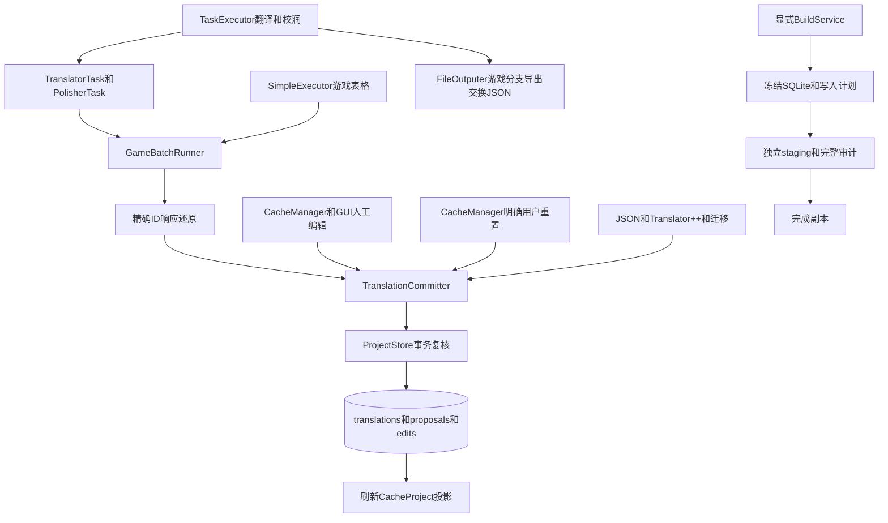

# 译文入口、输出与副作用审查（0.22–0.23）

0.25源码最新结论：全文分析已接通游戏执行和规范候选保存，A03按调用图及逐入口
清单收口为已实现；详见本文末节与ANALYSIS_WORKFLOW_EVIDENCE.md。下文按版本保留
早期反例和限制，0.25新EXE及真实模型仍未验收。

2026-10-19，Codex。对应开发计划11.4、14及A03。对象为本分支源码，运行提交以交付
回执为准。本记录给出调用图、已执行证据和未完成改造，不将静态源码或测试桩扩张为
真实模型、自然玩法或干净机器验收。A03仍保持部分实现。

0.23源码补充：下文0.22的“runner不消费previous_items、上下文与分组成本待实现”缺口
现已有源码和直接检查；主翻译/校润及表格共用每轮规范图、消费有界规范源参考，
实际3173批准备16.461秒。校润缺有效译文也已明确拒绝。新旧证据边界、三项预审
缺陷及修复见CONTEXT_PREPARATION_EVIDENCE.md；其他重置、输出预检、质量报告
和真实模型入口仍按下文清单继续，本补充不使A03或完整计划完成。

Codex后续补查并修复：CacheBridge从当前有效origin=polish恢复POLISHED，已校润条目
刷新后不会再次进入校润轮次；人工改译、来源陈旧与人工锁仍优先。5个先失败用例、
联合34项和该时点源码605/207通过，详见同一上下文证据末节。该时点的用户重置尚未
持久化；后续独立实现与验收见下节，不能把校润投影修复当作重置权威化证据。

## 0.23 后续：明确用户重置进入权威事务

实际入口为BottomCommandBar.command_reset_status → CacheManager.reset_project_status →
route_cache_reset → TranslationCommitter.reset_task_status → ProjectStore.reset_task_status。
保留原有用户确认，并说明已有译文和人工锁保留；预期保存/版本错误显示失败，不冒充
“重置成功”。普通文档保留原缓存重置和保存行为，不进入游戏事务。

此处描述SQL提交失败。SQL提交成功后若视图刷新失败，现采用“已保存，请重新加载”
独立结果，详情见下节；它不会撤销已经保存的重置，也不显示为事务拒绝。

游戏重置不删除或清空译文，不使有效译文失效，而是记录重新处理的调度意图。
同一BEGIN IMMEDIATE内核对project_id、dataset、完整规范单元覆盖、source_hash、
eligible行的CAS、人工锁、ownership及当前token/显示值策略；依据数据库状态选取目标，
不信任缓存TRANSLATED/POLISHED标记。翻译重置处理有效未锁定接受项；校润重置只处理
origin=polish的有效未锁定接受项。未知控制符来源仍排除。

目标行保持text/source_hash/status/manual_locked，revision加一，origin记录
reset-translate或reset-polish；proposal/edit保留原文本与previous_origin。整次操作
content_revision只加一次，dataset不变，不创建模型job。这样既保留已接受译文，也让
重置前请求的旧revision发生冲突。新模型/人工接受可以替换调度意图；重复重置同一
待处理意图为零改动。普通commit禁止伪造这两个保留origin，必须走明确重置API。

全部目标、proposal/edit和全局revision一次事务提交，第二项审计故障或中途真实
进程退出均整体回滚。提交之后按规范投影刷新缓存，保留未知控制符排除状态及当前锁；
不依赖普通缓存JSON保存来持久化任务重置。accepted文本仍可用于构建，重置表示重新
排队，不表示清除批准内容。该行为不新增物理列或改变译文控制符权限。

独立用例先18失败/3通过，补充排除刷新、保留origin及单事务检查后1失败/24通过；
修复排除刷新后与校润、真实任务入口、人工原子编辑和ownership合计63项通过。
覆盖缓存伪造/缺项/重复项、旧来源/版本、错误模式、用户取消与失败toast、迟到结果
冲突、新接受清除意图、审计中途故障与真实Windows子进程退出78。UI采用真实命令
方法和受控确认框，不能称为自然鼠标点击或冻结EXE验证。

当前17716单元主库的两个SQLite备份分别运行真实CacheManager重置及重载。翻译重置
29条，实测1.082秒；校润重置0条、1.178秒（原库29接受项均非校润，无锁定项）。
没有为实测临时新增译文或解锁，非零校润/锁定正例来自上述合成用例。有效文字、来源
hash、锁、status、完整单元图、捕获文件表及jobs保持；仅副本的重置origin、revision
和proposal/edit按预期改变，重复操作无改动。原主库SHA3343edfe…38dae5保持，未打开
原游戏文件，无provider、无游戏启动。证据在work/current-task-reset-v23/
eb1bc20ca22e497e9d28e9583194bf5c/result.json和work/acceptance/rpg-task-reset-v23-*。

最终源码630 passed /207 subtests passed（含安装版Translator++8.8.9），零skip/fail/error，
既有依赖警告1，167.34秒。work/acceptance/rpg-0.23-full-source-v3.log/xml，保留临时
目录f592967c411e42419a5db16e574b94b4。新冻结程序另验；A03输出预检、统一质量报告
和完整真实模型入口仍未完成，本项不使A03或P0整体验收通过。

## 0.23 后续：输出预检、固定工程与合并质量报告

GameOutputPolicy为手动导出、翻译/校润自动输出及独立质量报告提供共用边界。预检在
模型和OpenCC之前执行，不创建输出目录；写入前再次校验。先核对原始词法路径组件，
复用safe_join拒绝junction/reparse、hardlink、ADS/保留名与非法父目录，再检查与原游戏
root的双向分离。工程内只允许AiNieeOutput、AiNieePolishOutput和exports子树；工程根、
捕获source、jobs、migrations、builds、validations等权威区域拒绝，独立外部目录可用。
这保留TaskConfig对game-project.json生成的两个现有自动输出默认目录。

缓存须保有工程root、project_id及一致的单元root；RpgGame类型或游戏单元标记仍在、
root丢失时明确拒绝，不退回普通文档Writer。空单元root也不能被abspath解释为cwd。
Source/ordinary文档输出与旧通用检查语义保持；普通TXT真实Writer有独立保全检查。

FileOutputer游戏分支在工程锁和一致SQLite读取事务中导出规范交换数据；实际发布只
接受game-translations或game-validation种类、随机32位ID、safe_join与禁止覆盖的
atomic_write。质量报告每次独立文件，冻结同一秒也不互相覆盖；失败暂存按既有策略
保留。目录在取得数据之后被换为junction的反例仍被最终检查拒绝。

TranslationResultCheck对游戏改为读取规范SQLite投影，合并ValidationService的
ownership、控制符/值约束与现有普通质量启发式。锁定或已校润的有效文本也检查；
重新排队与已接受覆盖率分开记录。原通用检查仅以collect_only读取模式复用，直接
调用其旧写入路径处理游戏会拒绝。报告包含project/dataset/content revision、
deterministic、quality、scheduling和可定位unit_id；passed反映该静态合并检查，
runtime_validation及model_quality_validation明确not_run。本报告不运行原游戏，
不重新验证原游戏文件字节或渲染字体/窗口，不作为全P0或真实模型质量验收。

主翻译/校润在本轮固定工程与已检目录上工作，每轮及输出前复核工程未切换。
游戏报告在TASK_STOP_DONE通知之前完成；完成通知携带root/project_id，监听者随后
切换工程不会把新工程报告写入旧目录。手动导出的OpenCC也绑定原投影，转换中切换
工程时停止后续导出。逐单元已接受的翻译/转换保留在原工程审计中，中断后续导出
不会撤销这些有效提交。普通文档的完成顺序保留。

直接入口反例先28失败；随后补充保留名称不覆盖、真实TXT、late junction、缺失/混合
身份、空root及请求/完成事件内切换。缺root用例曾误用set_extra(None)，该setter会
忽略None；已改为真实移除字段，重新取得7失败/1通过，未放宽产品检查。工程切换
专项先7失败，固定scope与报告顺序后通过；另以真实转换方法和数据库证明转换途中
切换不会改写另一个同ID/revision工程。联合上下文、重置、人工事务共96项通过。

真实主控制器的translate和polish均跑过线程池→本地请求桩→SQLite→交换Writer→
合并报告完整链路，默认目录/正确角色、全部文件清单与完成事件时机逐项核对；
该链路没有真实provider或自然GUI点击。固定目录和SourceController证明不能扩张
成TASK_START全部消费者的工程/job协议已完成，该项继续审查。

当前17716单元主库SQLite备份实际导出17716行、约8.06MB，0.475秒；合并静态报告
约6.46MB，1.200秒。9570条捕获文件记录、规范图、29条已有文本及锁、revision、
proposal/edit/metadata/jobs均保持，原主库SHA3343edfe…38dae5保持，原游戏未修改。
四个保护输出位置均拒绝。确定性检查通过且无issue；报告诚实为passed=false：17687
条未译，另有data/Skills.json一条已有人工样稿的1→0换行提示，样稿保持供后续翻译
验收。本轮未修改它来使报告变绿。没有模型请求或游戏启动。私有证据在
work/current-game-outputs-v23/5977cca553d0432e939a534d69e8e770/result.json，公开工程
不含该交换/报告全文。最终源码679 passed /207 subtests passed（含安装版T++8.8.9），
零skip/fail/error、既有依赖警告1，162.78秒；日志/JUnit为
work/acceptance/rpg-0.23-full-source-v5.log/xml，保留临时目录
1d8187f05ffb4147b21a8ea2f1bf21bf。前一673项完整运行和所有失败用例也保留。
新EXE另验，A03/完整计划保持部分。

## 权威写入图

游戏分流使用GameBatchRunner，未使用计划示例的result_sink参数。普通文档仍走原处理
及CacheItem内存结果；游戏译文由SQLite决定是否接受，UI通知不产生接受译文。

## 11.4逐入口清单

| 入口与实际符号 | 当前游戏路径与权威边界 | 直接证据与待补部分 |
| --- | --- | --- |
| TranslatorTask.prepare / unit_translation_task | is_game_batch后由GameBatchRunner保护原文、请求、按ID提交，提前避开普通zip响应直写 | GameBatch、表格、迟到及重复ID测试已执行；上游这两个方法直接供应商端到端待补 |
| PolisherTask.prepare / unit_polish_task | 同一runner，mode=polish，经提交器接受结果 | 有效译文按原文控制符复核；缺少当前有效译文明确拒绝，不回退日文 |
| CacheManager.update_item_text | route_cache_edit只接受translated_text；来源只读；提交后从SQLite回读 | 人工GUI和保护测试已执行；缓存改原文不能成为新来源版本 |
| update_generated_translation | sync_generated_cache仅从SQLite刷新，不接受任意UI文字 | 过时通知反例通过；普通文档仍用原内存更新 |
| generate_item_chunks / generate_previous_chunks | 完整文件连续scene区段先于状态过滤，再应用预算和区段内lookback；runner消费规范只读参考 | 源码主入口、当前17716图/279选项请求/3173批准备已验；D02仍保留真实provider与新EXE边界 |
| TaskExecutor.translation_start_target / polish_start_target | 固定本轮工程/输出目录并预检；每批job/租约，等待接口不持写锁；游戏报告先于完成通知 | scope切换反例及Done root/id通过；TASK_START全部消费者的project/job协议仍待完整审查 |
| _convert_translated_text_with_opencc | 控制符先保护，转换可译部分，再route_cache_edit(origin=opencc) | 实际OpenCC与控制符合成检查通过；逐条提交，后条失败不回滚前条 |
| task_manual_export / 翻译及校润自动输出 | 共用GameOutputPolicy预检及规范交换导出，不自动构建 | provider/OpenCC前预检；写前重验；禁权威目录/覆写/身份降级；原工程scope绑定 |
| TextFilter.filter_project | 游戏提取器先分类，跳过通用代码/语言猜测，避免丢弃短CJK名称或控制符 | 当前实现决定；不能写成已完整采用普通过滤规则，独立入口对照待补 |
| TranslationResultCheck.check_cache | 规范快照叠加确定性与通用质量，普通收集器仅只读复用 | 直接报告路径同一预检，独立JSON禁止覆盖，静态/运行/模型质量范围分列 |

“待补”是可执行清单，不是把未知入口交给人工确认后当作完成。后续每项均需源码定位、
失败复现和直接复测；此记录不改变A03、D02或P0的验收条件。

## 接受文本的SQLite位置

在ModuleFolders、UserInterface、Tools的Python源码中检索并跟踪translations的INSERT/UPDATE：

| 位置 | 写入类型 | 限制 |
| --- | --- | --- |
| ProjectStore.commit | 接受文本、revision、来源/status和proposal/edit；明确人工命令可同时设置目标锁 | BEGIN IMMEDIATE内复核schema/capabilities、源hash、CAS、锁、token和显示值；普通路径不传manual_lock |
| set_locked | 锁元数据，必要时创建空未译rev0占位 | 不接受新的翻译文本，不是绕过提交器的文本导入 |
| reset_task_status | 保留接受文本/锁，推进CAS，记录重新排队origin及proposal/edit | 明确用户命令、完整图/来源/版本/策略复核和整次事务；普通commit拒绝伪造保留origin |
| replace_units | 更新原文/位置图，将来源变化的旧译文标stale并递增修订 | 不将旧文本改成新译文；图与提取完成原子提交 |

submit调用store.commit；accept_response核对精确ID集合、还原标记后逐单元提交。
批内已接受项可保留，其他条目拒绝时job可为FAILED，不是整批全部回滚的接口。
请求身份重放由Store处理；迟到取消响应只保留审计。

明确人工编辑是edit_manual，locked必须精确bool，文本与目标锁一次事务提交。同文锁
不增加接受文本revision；stale同文重批必须增rev。旧GUI暂时解锁的三事务已移除，
真实退出和拒绝稳定性见MANUAL_EDIT_ATOMIC_EVIDENCE.md。

其余接受调用者为GameProjectService.import_translations、CacheBridge.route_cache_edit、
MigrationService.apply_migration、TranslatorPlusPlusBridge.import_exchange和GameBatchRunner。
BackendCandidate/Build/Font/Validation对提交器的调用是校验或策略读取，不接受候选译文。
ImageService.confirm_regions定义虚拟图片来源并replace_units；OCR不自动成为来源或接受
译文，图片翻译仍经提交器，预览/批准是产物元数据。

JSON导入支持带source_hash/expected_revision的完整行，也支持用户明确提交的ID映射，
后者按当前版本编辑。导出保留版本列，删列后不再具有旧导出版本保护。重复ID拒绝时，
前面的有效行可能已逐条提交，并不承诺整文件原子导入。

## 发现与后续实施顺序

1. 已修复：场景混批、表格顺序、缓存伪造scene、空scene混排、bool行号误选。
2. 已修复：人工编辑临时解锁、None被当普通提交、空行锁错误控制符问题、元数据锁
   忽略显式阻断issue；异常回滚和真实进程退出分别验证。
3. 0.23已实现有界规范源参考及每轮共享工程图，实际3173批准备16.461秒；真实provider
   和新冻结程序仍各自验收，不以准备耗时替代实际翻译性能。
4. 0.23已修复用户重置只改投影的问题；权威事务、CAS、审计、重载、真实中断及当前
   17716单元副本重置有独立证据，见本文件新增重置节。
5. 0.23源码已补：OpenCC/provider之前的输出预检、统一游戏质量报告、独立写入边界、
   工程scope及Done通知顺序；当前源码/桩与真实副本证据见新增节，新EXE另验。
   TASK_START全部消费者的project/job协议和损坏身份下其他写入入口仍继续审查。
   普通文档原有输出语义不由游戏改造擅自改变。
6. 手工清空含控制符译文仍受token约束；本轮没有偷偷改变空译文语义。真实接口逐入口
   验收继续按用户决定后置。

## 第三方副作用矩阵

| 入口 | 来源与允许产物 | 核对和明确拒绝 |
| --- | --- | --- |
| 原生JSON/JS | 捕获bytes、批准locator、staging选定文件 | JSON typed差异；JS AST/目标值/区间外bytes；来源不符拒绝 |
| Stev整目录构建 | 完整清单副本，真实ReadGame/ProgramData/分轮InjectGame | 输入/轮次/输出与地址证明、config/source指纹；私有重复键归并明示且不可写；不修补SDK失败 |
| Stev单文件候选 | 独立副本/内存API和sidecar | 与整目录独立；候选没有显示或成品回写权限 |
| SExtractor默认构建 | 新worker真实main导出/导入、固定ctrl/list和engine.ini | 输出清单、来源/配置/位置及原生差异；未声明写入、取消或来源变化拒绝，不降级 |
| SExtractor比较 | 独立候选内存API | 不替代真实main回写证明 |
| RPGMTL JSON/CommonEvents/JS | 指定真实内存插件、虚拟子工程或SDK来源切片 | occurrence/子组/AST/原生预期；未请求位置不得广播 |
| Translator++8.8.9 | 登记.trans/绑定、固定loopback API模板 | 版本、工程/单元身份、双hash/revision；桥接不直接写原游戏，导出候选仍审计 |
| OCR/图片 | 只读资源、显式确认框、候选JSON/预览/批准图片 | 源图/System/key/尺寸/框/区域外像素/字体及批准hash；OCR不直接接受译文 |

外部Python/Node/OCR进程使用owned runner约束超时、管道及进程树退出。工具guard和
Python audit hook只是已审查工具的边界，不是OS沙箱。各入口正反例、指纹、退出及完整
构建见相应BACKEND/STEV/SEXTRACTOR/RPGMTL/TRANSLATORPP/IMAGE/PROCESS_OWNERSHIP证据；
新EXE以0.22回执为准，不宣称已测试恶意库的全部逃逸能力。

## 协作与验收范围

DeepSeek最初审计草案772.72秒返回，working_directory及两个不存在文件的grep被拒，
共3次，按失败交接。保护文件未变；Codex独立核对14个after hash及249次read/grep路径，
未发现游戏/凭据读取。草案没有直接当作完成证据。本记录由Codex重新跟踪源码、SQL、
失败复现和独立验收整理，仍保留上述缺口。

定向59项/9子检查、当前游戏只读图和原装后端证据分别按其范围使用。没有本轮真实
模型、完整自然玩法或干净机器证明，不将测试桩解释为供应商通过。私有脚本、原始草案、
素材和worker日志只在work，不进入软件/源码包。

## 0.23 后续：身份损坏拒绝、状态通知及已保存后的重载

共用GameCacheIdentity按RpgGame类型、工程root字段存在或条目保留的game字段识别游戏；
空字段和丢失root仍是游戏候选，不能降级为普通文档编辑/重置/请求。日文内容和通用
unit_id字段不用于猜测游戏类型。root/project_id与选中项root均需对应权威工程。
人工改单项及生成结果通知仅检查该项，不为每次改字遍历全部工程图；完整导出/重置/
载入则检查完整范围。直接任务的缺失、空及异常root在普通TextProcessor之前拒绝。
表格任务在try内部先校验身份，再初始化配置和请求；错误仍发出完成事件。

生成通知只回读一致SQLite快照，检查来源hash及请求显示的状态是否与规范状态一致；
同文的旧TRANSLATED通知不能取消reset-translate、POLISHED或人工锁状态。单项与全图
投影共用状态推导，未知控制符来源的EXCLUDED不会在单行刷新时消失。旧来源缓存不会
显示新来源的接受文本。表格校润通知明确携带POLISHED，实际BasicTablePage消费后保持。

ResetProjectionRefreshRequired表示SQL重置已完成，但后续投影重建/应用失败，携带实际
changed_count。缓存仅标记game_projection_refresh_required，拒绝新的游戏编辑、重置、
表格及输出；此标记不作为数据库身份或接受权限。用户在游戏汉化页重开工程并再次
“送往 AiNiee 翻译”，重新构建规范视图后解除限制。显式refresh_projection仍验证真实
root/project_id，并用一致读取重建。BottomCommandBar显示保存及重载警告，不误报SQL
失败或成功刷新。数据库事务本身失败仍按原失败路径处理。

新增51项检查，身份反例先36失败/4通过，第一轮状态/重载补充3失败/45通过；实现后
相关124项通过。第一次联合回归发现单项刷新抛错破坏既有来源陈旧清空语义，已恢复：
通知入口拒绝过期来源，底层回读清空旧来源文字，仍保留人工锁/来源排除优先。最终完整
源码730 passed /207 subtests passed，含安装版T++8.8.9，零skip/fail/error、既有警告1，
167.53秒。所有失败与临时目录保留。

当前游戏17716单元SQLite备份实际检查五种身份损坏，每种拒绝编辑/重置/重载/输出及
生成通知。注入提交后刷新故障，29条重置已保存，旧视图拒绝操作，重载后状态恢复，
重复重置为零；接受文本/源hash/状态/锁、图/文件/jobs及原主库hash保持。源码实际应用
进程通过七组身份/共享参考与选项问题/本地请求提交/真实表格消费/重载/交换及合并报告/
未知控制符检查。经可信且故意失败的私有SDK导入钩子调用真实模块；没有把钩子当作
成功后端候选、普通按钮点击、操作系统沙箱、真实provider或自然玩法验收。

新EXE另验。TASK_START全部生产者/消费者完整project/job/dataset协议仍待完成；本轮
Done root/id仅是生产者元数据，不能据此声称消费者全部过滤过期任务。A03和D02保持
部分实现，完整计划与23已实现/10部分/1用户后置统计不变。

## 0.24源码：UI状态类型不能沿用直接回读的可选参数

0.23封包后独立复查实际BasicTablePage消费发现：事件显式translation_status=None时，
sync_generated_cache把None理解为不比较状态，随后UI默认将POLISHED改为TRANSLATED。
修正定位fixture后1失败/2通过，原现场保留。0.24在CacheManager游戏通知入口要求精确
int，None/bool/字符串均拒绝；底层直接sync_generated_cache省略状态的回读仍兼容。
三项真实消费检查与相关77项通过，完整源码733 passed /207 subtests passed，包含
安装版T++8.8.9，零skip/fail/error、既有警告1，196.21秒。该类型守卫尚未进入新EXE；
0.23封存及其回执保持。A03完整事件协议仍继续实现，不把本修复当成Start/Done已修复。

## 0.24进行中：局部执行scope基础，不是已接线协议

GameTaskScope/GameTaskCoordinator为每个CacheManager维护一个内存执行及保留的终结
身份，独立于序列化extra和SQLite请求job。预留/接收/停止/终结、Done一次消费、迟到
执行隔离和真实job登记有明确接口；不是全局工程信任表，不伪造提前存在的job_id。
投影新增game_dataset_revision；开始核验可检查全部项，逐请求仅复核身份/dataset，
不重复遍历整个图。真实持久job的绑定接口在停止后拒绝登记，实际runner接线仍待做。

16项新增scope核心检查通过，包括两线程抢占仅一次预留、同工程新run、替换投影、
缓存与权威dataset不同、畸形版本、Done重复消费、管理器隔离、真实Store job与逐请求
无全图扫描。相关实际载入/主准备/通知共40项通过，既有警告1。这些接口尚未接入
Start/Stop/进度/Done、自动保存、延迟Continue或表格/监控消费；原有两个控制RED未
因此修复。源全量733项仅证明前一类型守卫提交，不覆盖本次新增基础。新全量和新EXE
在后续集成完成后单独验证。A03及完整计划仍未完成。

## 0.24主任务接线完成后的增量（2026-10-20）

上述scope基础已接入主翻译/校润实际生产者和消费者；此前两个Start/Done控制RED已
修复。排队前预留、身份与规范dataset核验、活动真实job绑定与停止、捕获统计、Done
单次消费、监控和Qt延迟Continue接收端均已覆盖。逐行SQL模型提交补充epoch、实际
请求目标/角色/阶段守卫；同执行进度按锁内快照计数拒绝乱序，两个新反例先失败再通过。
完整源码818 passed /207 subtests passed，含T++8.8.9、零skip/fail/error，201.88秒。
详见MAIN_TASK_SCOPE_EVIDENCE.md。表格多文件组完整协议及新EXE仍待做，不以主入口
接线扩张为A03或完整计划已完成；23/10/1统计保持。

## 0.24多文件表格执行组（2026-10-20，后续增量）

Basic/Search/EditableIssue 的翻译选区及 Basic 校润现在排队前捕获投影和scope；多个
文件一次排队，SimpleExecutor先接收身份再创建线程。共享一次规范准备和限流，配置
并发保留，实际job绑定/活动取消与主入口共用；三页面在更新单元格或提示前核验原
建表投影与scope。短OS锁段由同一preparation内存锁协调，provider在锁外；全部在途
及排队future收尾后只发一次组终结，主停止按钮消费该终结才恢复闲置。

修正直接服务预留不能覆盖既有STOPING，相关122项通过。当前17716单元工程保留副本
两文件/两并发本地请求/两个真实COMPLETED job/两行提交/一次终结通过，29条已有译文、
规范图/文件/dataset和主库保持。实际源码offscreen视图载入退出0，最大心跳195.8751ms；
完整源码最新结果见IMPLEMENTATION_STATUS.md，源码不替代0.24 EXE。

AI自动校对仍经 TABLE_PROOFREAD_START -> TaskExecutor.table_proofread_start/target ->
ProofreadTask，当前未接游戏scope/规范请求。其无scope消息被游戏表格拒绝，不能
据此声称校对能力已实现或provider调用有工程隔离；这是下一步明确待处理入口。
完整计划、A03/D02和23/10/1统计保持。详见TABLE_TASK_SCOPE_EVIDENCE.md。

## 0.24原生AI自动校对（2026-10-20，更新上一节待处理结论）

TABLE_PROOFREAD_START现捕获table-proofread scope，TaskExecutor入场核验后调用共用
GameTableExecution，普通文档仍走原ProofreadTask，带游戏身份不能进入旧worker。
原文和当前接受译文从规范库读取，UI仅提供索引和有界提示；来源字段保持，校对角色
独立。单元ID/源marker/固定CAS以及锁、dataset和writer规则均走同一提交边界。
每次尝试实际POLISH job带request_mode=proofread，接受origin=polish并恢复POLISHED。
至多两次格式/响应重试，不将CAS冲突的新人工版本重新授权给旧请求。

新增25项、相关170项通过。完整源码861 passed /207 subtests passed，含T++8.8.9、
零skip/fail/error、既有警告1，208.68秒；当前游戏副本两并发校对和主库/未选译文保全
通过。实际源码应用进程四组边界另通过，详见PROOFREAD_SCOPE_EVIDENCE.md。新EXE、
真实provider及完整计划单独验收，不扩张为A03/P0全部通过，23/10/1保持。

## 0.24封存及剩余全文分析入口（2026-10-20）

运行提交c04e572的新ZIP已通过28组实际EXE检查，包含主/表格/校对scope四组及上一版
八组身份/上下文/输出检查；源码与新EXE各完成Stev/SExtractor当前游戏9570文件
测试构建，来源/主库/图/接受译文及锁保持。七项checksum和3639软件文件核对通过。
详见DELIVERY_RECEIPT_0.24.md；这些结果更新上文“新EXE另验”的历史结论。

继续追踪普通助手时，源码受控实际方法确认以下未修复路径：

| 入口 | 当前行为 | 后续要求 |
| --- | --- | --- |
| AnalysisPage.start_analysis → TaskExecutor.analysis_task_start | 空/外工程数据仍进入旧分析线程调度，无游戏scope认领 | 游戏须接管执行或明确拒绝该能力，线程/配置/provider之前处理 |
| AnalysisTask.run → CacheManager.set_analysis_data | 结果依据届时的cache_manager.project保存内存分析元数据 | 固定生产工程、规范来源及完成身份；不得晚到写入另一工程 |
| AnalysisPage.on_analysis_task_done | 外工程完成消息仍更新当前game的analysis_v1并要求保存 | 消费端先校验原执行及投影，拒绝外工程/旧执行消息 |
| AnalysisPage.stop_analysis → TASK_STOP | 旧分析未登记scope，无scope停止被游戏控制器拒绝 | 新任务登记/取消/收尾一致；接管前在游戏工程明确停用 |

证据为work/analysis-boundary-v24/2e2d6e80fd7d4127aac4dc50385e6bd3/result.json及
452a6079cf7a4e60a5fcfc20b765cd35/result.json，使用实际方法和合成CacheProject、
替代线程工厂/界面控件；未创建真实线程、请求模型或写入SQL/原主库/原游戏。
该反例在861项完整源码门槛之外，只证明控制和内存元数据边界，不声称已证明SQLite
译文串写或已在冻结EXE复现。A03继续保持部分，接管或明确能力限制为下一项工作。

## 0.25源码：全文分析及A03入口清单收口

上节源码反例已经接通并通过实际Qt流程复测：AnalysisPage预留analysis scope，
TaskExecutor认领后复用AnalysisTask，两阶段均从规范单元取原文，单个ANALYSIS job
关联执行；规范候选以独立revision和完成状态同事务保存，迟到事件拒绝。停止共用
现有协调器，等排队和在途收尾。人工改候选优先、失败保留旧候选，重载恢复。
具体路径与源码边界见ANALYSIS_WORKFLOW_EVIDENCE.md，新EXE尚未构建。

剩余普通助手的产品边界：PromptDictionaryPage.glossary_translation只把表格候选交给
SimpleExecutor.glossary_translation，完成消费更新应用配置prompt_dictionary_data，
不调用CacheManager游戏编辑或SQLite译文提交；接口测试仅验证接口配置。词典是全局
设置，用户通过现有导入/导出切换游戏词典，在汉化任务运行时避免并行改词典/测试
接口。它们不扩展为游戏单元任务，也不为共享设置新增底层同步/恢复框架。

按原A03任务核对：11.4列出的翻译、校润、人工/生成编辑、场景上下文、Start/Stop/Done、
OpenCC、导入/自动输出、TextFilter及质量报告均有调用图、游戏分流/权威边界和直接
证据；表格/AI校对、全文分析与独立词典助手的边界已列明。第三方真实工具写入路径
及副作用证据见各后端记录。据此A03源码入口梳理已实现；真实provider、0.25 EXE、
全游戏规则/字体与自然玩法由其余任务跟踪，不以此声明整个计划完成。
